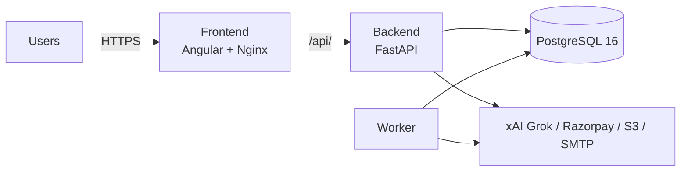

# DentalPilot AI — Production Deployment

**Audience:** DevOps/platform engineers and release managers.
**Scope:** production deployment only. Local development is in [`docs/notion/SETUP_AND_DEPLOYMENT.md`](docs/notion/SETUP_AND_DEPLOYMENT.md). Environment variables are in [`ENVIRONMENT.md`](ENVIRONMENT.md). Architecture is in [`docs/notion/TECHNICAL_ARCHITECTURE.md`](docs/notion/TECHNICAL_ARCHITECTURE.md).

Two supported production targets:

1. **Railway** (managed) — frontend, backend, worker, PostgreSQL.
2. **Docker Compose VPS** — GHCR images, Nginx, SSL, PostgreSQL.

> **Production never uses development hot reload or source bind mounts.** The backend runs `uvicorn` without `--reload`; the frontend is a static Angular build served by Nginx.

---

## 1. Production architecture



| Service | Railway | Docker Compose VPS |
|---|---|---|
| Frontend | Dockerfile (`node:20-alpine` → `nginx:alpine`) | GHCR `frontend` image |
| Backend | Nixpacks (`railway.toml`) | GHCR `backend` image |
| Worker | same image, custom start | GHCR `backend` image, custom command |
| PostgreSQL | Railway PostgreSQL | `postgres:16-alpine` |
| Redis | **not used** | **not used** |

### 1.1 Production service inventory

| Service | Public access | Port | Purpose | Health / verification |
|---|---|---|---|---|
| Frontend (Nginx + Angular) | `https://dentalpilot.in`, `https://www.dentalpilot.in` | `443` (TLS), `80` → 443 | Static SPA + `/api/` reverse proxy | `curl -I https://dentalpilot.in/health` → `200 healthy` |
| Backend API (FastAPI) | `https://api.dentalpilot.in` | `443` (TLS) | REST API `/api/v1` | `curl https://api.dentalpilot.in/health`; `/health/live`; `/health/ready` |
| Swagger UI | `https://api.dentalpilot.in/docs` | `443` | Interactive API docs | `curl -I https://api.dentalpilot.in/docs` |
| OpenAPI JSON | `https://api.dentalpilot.in/openapi.json` | `443` | Schema | `curl https://api.dentalpilot.in/openapi.json` |
| Worker | **none** (internal service) | — | Email / communication / billing loops | `railway logs` / `docker compose logs workers`; no HTTP health |
| PostgreSQL | **none** (private) | `5432` internal | Database | `pg_isready`; Railway health |
| Migration | **none** (one-shot) | — | `alembic upgrade head` | Exit code 0; `logs migrate` |
| Redis | **excluded** | — | Not used by app code | — |

**Public vs internal:** only the frontend and backend API are public. PostgreSQL is private (Railway private networking / Docker network). The worker and migration services have no public endpoint.

**Staging:** frontend on `http://<staging-host>:8080` (HTTP-only, `nginx/staging/default.conf`); backend via `https://api.staging.dentalpilot.in`; PostgreSQL private.

**Production access summary:**

- Frontend: `https://dentalpilot.in`
- API: `https://api.dentalpilot.in/api/v1`
- Health: `https://api.dentalpilot.in/health`, `/health/ready`
- Swagger: `https://api.dentalpilot.in/docs`
- OpenAPI: `https://api.dentalpilot.in/openapi.json`

---

## 2. Railway deployment

### 2.1 Create the project

1. Railway → **New Project → Deploy from GitHub repo** (`saman2ny/otheryn-platform`).
2. Add the services below, setting **Settings → Source → Root Directory** for each.

### 2.2 PostgreSQL

1. **New → Database → PostgreSQL**.
2. In the backend and worker **Variables**, set:

```dotenv
DATABASE_URL=postgresql+psycopg://${{Postgres.PGUSER}}:${{Postgres.PGPASSWORD}}@${{Postgres.PGHOST}}:${{Postgres.PGPORT}}/${{Postgres.PGDATABASE}}
```

> **Critical:** Railway's `${{Postgres.DATABASE_URL}}` is `postgresql://...`; SQLAlchemy would select `psycopg2`, which is **not installed**. Always use `postgresql+psycopg://`.
3. Use Railway private networking; do not expose Postgres publicly.
4. **Redis is not used** — do not add a Redis service.

### 2.3 Backend

1. Root directory: `products/healthcare/dental/dentalpilot-ai/backend` (monorepo) or `backend` (standalone).
2. Builder: **Nixpacks** (`railway.toml`). Railway reads `railway.toml` and `nixpacks.toml` from the service root.
3. Start command (from `railway.toml`, do **not** override in the dashboard):

```bash
alembic upgrade head && uvicorn app.main:app --host 0.0.0.0 --port $PORT
```

4. Health check path: `/health`.
5. Generate a domain (`api.dentalpilot.in`), attach TLS.
6. Required variables: `DATABASE_URL`, `JWT_SECRET`, `APP_ENVIRONMENT=production`, `CORS_ORIGINS`.
7. Optional: `XAI_*`, `RAZORPAY_*`, `S3_*`, `AWS_REGION`, `SMTP_*`, `WHATSAPP_*`.

> **No `--reload` in production.** The start command above has none.

### 2.4 Worker

1. Add a **separate Railway service** from the same repo/root.
2. Custom start command:

```bash
python -m app.workers.run_workers
```

3. Same `DATABASE_URL`, `JWT_SECRET`, `APP_ENVIRONMENT` and integration variables as the backend.
4. No public domain, no health path.
5. The worker **must not run migrations** — the backend start command runs `alembic upgrade head`; the worker only polls.
6. Logs: Railway → Deployments → Deploy Logs.

### 2.5 Frontend

1. Root directory: `products/healthcare/dental/dentalpilot-ai/frontend` (or `frontend`).
2. Railway detects `frontend/Dockerfile` (`node:20-alpine` builder → `npm ci && npm run build` → `nginx:alpine`).
3. **Build-time API URL:** `src/environments/environment.prod.ts` → `https://api.dentalpilot.in/api/v1`. Changing Railway variables does **not** change the bundle; edit the file and rebuild.
4. Generate a domain (`dentalpilot.in`, `www.dentalpilot.in`), attach TLS.
5. Nginx serves the SPA, proxies `/api/` to `https://api.dentalpilot.in`, returns `/health` = `healthy`, caches hashed assets.

### 2.6 Migrations on Railway

- The backend start command runs `alembic upgrade head` on every deploy.
- Do **not** add a separate migration service.
- Migrations are forward-only.
- Inspect:

```bash
railway run alembic current
railway run alembic history
```

### 2.7 Verify and roll back

```bash
curl https://api.dentalpilot.in/health
curl https://api.dentalpilot.in/health/ready
curl -I https://dentalpilot.in/health
```

- **Logs:** Railway → service → Deployments → Build/Deploy/HTTP Logs, or `railway logs`.
- **Rollback:** Railway → service → Deployments → previous deployment → Redeploy.
- Schema changes are forward-only; a destructive migration requires a restore or follow-up migration.

---

## 3. Docker Compose VPS deployment

### 3.1 Prerequisites

- Docker 24+ with Compose v2.
- A host with ports `80`/`443` free.
- SSL certificates in `nginx/ssl/`: `fullchain.pem`, `privkey.pem`, `chain.pem`.
- GHCR images built by CI (or built locally).

### 3.2 Environment

```bash
cp .env.production.example .env.production
# Edit .env.production: POSTGRES_PASSWORD, JWT_SECRET, CORS_ORIGINS, optional integrations
```

### 3.3 Deploy

```bash
./deploy.sh production
```

`deploy.sh`:

1. Sources `.env.production`.
2. Validates `POSTGRES_PASSWORD` and `JWT_SECRET`.
3. Pulls images (`${REGISTRY}/${IMAGE_NAME}-backend|frontend:${IMAGE_TAG}`).
4. Runs `docker compose ... up -d --remove-orphans`.
5. The one-shot `migrate` service runs `alembic upgrade head` before backend/workers.
5. Health-checks the frontend and backend.

For staging:

```bash
./deploy.sh staging
```

Staging uses `docker-compose.staging.yml` (HTTP-only, port `8080`, `nginx/staging/default.conf`).

### 3.5 Nginx

`nginx/conf.d/default.conf` (mounted by `docker-compose.yml`):

- Listens on `80` (redirects to HTTPS) and `443` (TLS).
- Proxies `/api/` to `http://backend` (preserving the `/api/` prefix).
- Adds HSTS, X-Frame-Options, nosniff, Referrer-Policy, Permissions-Policy.
- Caches hashed static assets for 1 year.
- `/health` returns `200 healthy`.

### 3.6 Migrations

- The one-shot `migrate` service runs `alembic upgrade head` before backend/workers.
- Do not run migrations manually during a normal deploy.
- Forward-only.

### 3.7 Backups and restore

```bash
# Backup
docker compose -f docker-compose.yml exec -T postgres pg_dump -U dentalpilot dentalpilot > dentalpilot-$(date +%F).sql

# Restore (destructive — verify first)
docker compose -f docker-compose.yml exec -T postgres psql -U dentalpilot dentalpilot < dentalpilot-YYYY-MM-DD.sql
```

- Enable provider-level backups/PITR where available.
- Test restore regularly.

### 3.8 Health checks and rollback

```bash
curl -f http://localhost/health
docker compose -f docker-compose.yml exec -T backend curl -sf http://localhost:8000/health
```

- Rollback: set `IMAGE_TAG` to the previous immutable tag in `.env.production`, then `./deploy.sh production`.
- Schema rollback requires a DB restore or a follow-up migration.

---

## 4. Environment variables and secrets

- **Never commit** `.env`, `.env.local`, `.env.production`, `.env.staging`.
- **Railway:** set variables in the service settings (or `railway variables --set`).
- **Compose VPS:** `.env.production` on the host, `chmod 600`.
- The complete variable reference is in [`ENVIRONMENT.md`](ENVIRONMENT.md).
- Production validation enforces a 32+ char `JWT_SECRET`, non-SQLite `DATABASE_URL`, no `*` CORS, and Razorpay webhook secret/plan IDs when Razorpay is configured.

---

## 5. Security

- HTTPS/TLS at the edge; HSTS.
- Explicit CORS origins.
- JWT (HS256), bcrypt passwords.
- Webhook signature verification (Razorpay).
- S3 private bucket + SSE/KMS.
- Audit events for sensitive actions.
- **Known gaps:** no app-level rate limiting, tokens in `localStorage`, logout no-op, partial audit coverage, no CSP. See [`AUDIT/PRODUCT_IMPLEMENTATION_AUDIT.md`](AUDIT/PRODUCT_IMPLEMENTATION_AUDIT.md).

---

## 6. Troubleshooting (including historical incidents)

| Symptom | Fix |
|---|---|
| Railway build: `No module named pip` | Do not override `[phases.install]` in `nixpacks.toml` (historical incident). |
| Railway serves an old commit | Check Deployments → Details → SHA; reconnect GitHub or redeploy. |
| `psycopg2` / driver error | `DATABASE_URL` must be `postgresql+psycopg://`. |
| `JWT_SECRET` error | 32+ chars, non-default. |
| CORS headers missing on 500 | `CatchAllExceptionMiddleware` must be before `CORSMiddleware` (historical bug). |
| Production 502 from frontend | Backend not running; check `/api/` proxy target. |
| Migrations failed | `railway logs` / `docker compose logs migrate`; fix migration; redeploy. |
| Worker not sending | Check worker logs; SMTP/WhatsApp vars. |
| Old images after deploy | `IMAGE_TAG` pinned; `docker compose pull`. |

---

## 7. Verification status

| Claim | Status |
|---|---|
| Compose config (production/staging) | Configuration validated (`docker compose config`) |
| Nginx config | Configuration validated (`nginx -t`) |
| Backend image build | Verified |
| Railway deployment | Documented — **not executed** |
| Production migrations | Documented — **not executed** |
| Backup/restore | Documented — **not executed** |
| Rollback | Documented — **not executed** |

No production deployment, migration, backup or rollback was executed during this documentation effort.

---

## Related documentation

- [`docs/notion/SETUP_AND_DEPLOYMENT.md`](docs/notion/SETUP_AND_DEPLOYMENT.md) — local Docker development.
- [`ENVIRONMENT.md`](ENVIRONMENT.md) — environment variables.
- [`docs/notion/TECHNICAL_ARCHITECTURE.md`](docs/notion/TECHNICAL_ARCHITECTURE.md) — architecture.
- [`docs/notion/BUSINESS_PROPOSAL.md`](docs/notion/BUSINESS_PROPOSAL.md) — business.
- [`RELEASE_NOTES.md`](RELEASE_NOTES.md) — release history.
- [`AUDIT/PRODUCT_IMPLEMENTATION_AUDIT.md`](AUDIT/PRODUCT_IMPLEMENTATION_AUDIT.md) — audit.