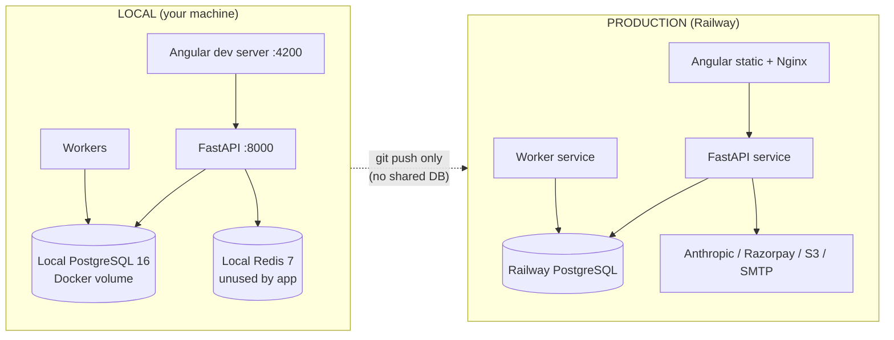

# DentalPilot AI — Environment Guide

This guide explains the difference between **local development**, **staging**, and **production**, and how to move between them without ever pointing a local process at production data.

> Golden rule: **local data and production data are separate.** A local `.env` must never contain production credentials, and a local `DATABASE_URL` must never point at a production database.

---

## 1. Mental model



- **Local** runs on your machine via Docker Compose (Postgres) or native Python (SQLite).
- **Production** runs on Railway: separate frontend, backend, worker and Postgres services.
- There is **no shared database** between local and production.

---

## 2. Local development

### 2.1 Option A — Docker Compose (recommended, PostgreSQL)

Files:

- `.env.local` — copy of `.env.local.example` (gitignored).
- `docker-compose.local.yml` — Postgres 16, Redis 7 (unused by app), one-shot `migrate`, FastAPI with hot reload, workers.

```bash
cd products/healthcare/dental/dentalpilot-ai

cp .env.local.example .env.local
# Edit .env.local:
#   POSTGRES_PASSWORD=<local-only password>
#   JWT_SECRET=<openssl rand -base64 48>
#   DATABASE_URL=postgresql+psycopg://dentalpilot:<same password>@postgres:5432/dentalpilot

docker compose -f docker-compose.local.yml up -d --build
```

Frontend (separate terminal):

```bash
cd frontend
npm ci
npm start          # http://localhost:4200
```

| Service | URL / port |
|---|---|
| Angular dev server | <http://localhost:4200> |
| FastAPI | <http://localhost:8000> |
| Swagger UI | <http://localhost:8000/docs> |
| Health | <http://localhost:8000/health> |
| PostgreSQL | `localhost:5432` (container `dentalpilot-local-postgres`) |
| Redis | `localhost:6379` (unused by the app) |

**Migrations:** the `migrate` service runs `alembic upgrade head` once per `up`; backend/workers wait for it. Do not run `alembic upgrade head` again manually in this mode.

### 2.2 Option B — Native (SQLite, no Docker)

```bash
cd backend
python3.12 -m venv .venv
source .venv/bin/activate
pip install -r requirements.txt
cp .env.example .env
# Edit .env: JWT_SECRET, DATABASE_URL=sqlite:///./dentalpilot.db

alembic upgrade head
python scripts/seed_hierarchy.py
uvicorn app.main:app --reload --port 8000
```

Workers (second terminal):

```bash
cd backend
source .venv/bin/activate
python -m app.workers.run_workers
```

Frontend (third terminal):

```bash
cd frontend
npm ci
npm start
```

> **Known SQLite issue:** `alembic upgrade head` may fail at revision `e78cbd0fad9c` with `ValueError: Constraint must have a name`. Use Option A (PostgreSQL) or apply the named-constraint fix. See [`backend/README.md`](backend/README.md#i-troubleshooting).

### 2.3 Local commands

```bash
# Status
docker compose -f docker-compose.local.yml ps

# Logs
docker compose -f docker-compose.local.yml logs -f backend workers

# Stop / restart
docker compose -f docker-compose.local.yml stop
docker compose -f docker-compose.local.yml restart backend workers

# Rebuild
docker compose -f docker-compose.local.yml up -d --build

# Reset local database (DESTRUCTIVE — local only)
docker compose -f docker-compose.local.yml down -v
docker compose -f docker-compose.local.yml up -d --build
```

### 2.4 Local tests

```bash
# Backend
cd backend && source .venv/bin/activate && pytest tests/ -q

# Frontend
cd frontend && npm test
```

### 2.5 Local demo accounts

`python scripts/seed_hierarchy.py` (password `password123`):

| Role | Email |
|---|---|
| Super Admin | `super-admin@dentalpilot.ai` |
| Clinic Owner | `owner@brightsmiledental.io` |
| Clinic Staff | `staff@brightsmiledental.io` |

Local only — never use in staging/production.

---

## 3. Staging

Staging is the same Docker Compose production stack with staging overrides:

```bash
cp .env.staging.example .env.staging
# Edit .env.staging: staging POSTGRES_PASSWORD, JWT_SECRET, CORS_ORIGINS, API keys

docker compose -f docker-compose.yml -f docker-compose.staging.yml up -d
```

- HTTP-only Nginx on `http://localhost:8080`.
- Uses the same GHCR images as production.
- Staging data is a **separate** Postgres volume (`postgres_data` in the Compose project `dentalpilot-staging`).
- Never reuse production credentials in staging.

---

## 4. Production (Railway)

### 4.1 Services

| Service | Root | Start | Public |
|---|---|---|---|
| `frontend` | `products/healthcare/dental/dentalpilot-ai/frontend` (or `frontend`) | Dockerfile → Nginx | Custom domain / `*.up.railway.app` |
| `backend` | `.../dentalpilot-ai/backend` (or `backend`) | `alembic upgrade head && uvicorn ...` (`railway.toml`) | `api.dentalpilot.in` |
| `worker` | same as backend | `python -m app.workers.run_workers` | No |
| `Postgres` | Railway-managed | — | Private only |
| `Redis` | **not used** | — | — |

### 4.2 Production variables (backend + worker)

Set in Railway → service → **Variables** (or `railway variables --set`):

```
DATABASE_URL=postgresql+psycopg://${{Postgres.PGUSER}}:${{Postgres.PGPASSWORD}}@${{Postgres.PGHOST}}:${{Postgres.PGPORT}}/${{Postgres.PGDATABASE}}
JWT_SECRET=<long random, 32+ chars>
APP_ENVIRONMENT=production
CORS_ORIGINS=["https://dentalpilot.in"]
ANTHROPIC_API_KEY=...
RAZORPAY_KEY_ID=...
RAZORPAY_KEY_SECRET=...
RAZORPAY_WEBHOOK_SECRET=...
RAZORPAY_PLAN_IDS={"starter_monthly":"...","starter_annual":"...", ...}
PATIENT_PAYMENT_CURRENCY=INR
S3_BUCKET=...
AWS_REGION=...
SMTP_HOST=...
SMTP_PORT=587
SMTP_USERNAME=...
SMTP_PASSWORD=...
SMTP_SENDER_EMAIL=...
WHATSAPP_PHONE_NUMBER_ID=...
WHATSAPP_ACCESS_TOKEN=...
WHATSAPP_WEBHOOK_VERIFY_TOKEN=...
```

> **Critical:** use `postgresql+psycopg://`. Railway's `${{Postgres.DATABASE_URL}}` is `postgresql://...` and SQLAlchemy would try `psycopg2`, which is not installed.

### 4.3 Production commands (Railway CLI)

```bash
railway login
railway link                 # link to the project/service
railway status
railway variables            # list variables
railway variables --set KEY=value
railway logs                 # runtime logs
railway run <command>        # run a command in the service context
railway redeploy             # redeploy the current service
railway open                 # open the service in the dashboard
```

**Deploy from local code** (uploads the current directory — use with care):

```bash
railway up
```

**Normal deploy:** push to the connected GitHub branch; Railway builds automatically.

### 4.4 Verify production

```bash
curl https://api.dentalpilot.in/health
curl https://api.dentalpilot.in/health/ready
curl https://api.dentalpilot.in/docs
curl -I https://dentalpilot.in/health
```

---

## 5. Environment variable comparison

| Variable | Local (`docker-compose.local.yml`) | Production (Railway) |
|---|---|---|
| `APP_ENVIRONMENT` | `development` | `production` |
| `DATABASE_URL` | `postgresql+psycopg://...@postgres:5432/...` or SQLite | `postgresql+psycopg://...` (Railway Postgres) |
| `JWT_SECRET` | local-only random | long random (32+) |
| `CORS_ORIGINS` | `["http://localhost:4200"]` | `["https://dentalpilot.in"]` |
| `ANTHROPIC_API_KEY` | optional/empty | set |
| `RAZORPAY_*` | optional/test | live + webhook secret + plan IDs |
| `S3_*` | optional | private bucket |
| `SMTP_*` | optional | set |
| `WHATSAPP_*` | optional | set |
| `POSTGRES_*` | local Compose | not used (Railway Postgres) |
| `REGISTRY` / `IMAGE_TAG` | Compose production only | not used by Railway Nixpacks |

---

## 6. Data separation and safety

### 6.1 Where data lives

| Environment | Database | Data location |
|---|---|---|
| Local Docker | PostgreSQL 16 | Docker volume `dentalpilot-local_postgres_data` |
| Local native | SQLite | `backend/dentalpilot.db` |
| Staging Compose | PostgreSQL 16 | Docker volume `dentalpilot_postgres_data` (staging project) |
| Production | Railway PostgreSQL | Railway-managed |

### 6.2 Never do these

- ❌ Put production `DATABASE_URL` / `JWT_SECRET` / API keys in `.env`, `.env.local`, or `.env.staging`.
- ❌ Point a local backend at a production Postgres host.
- ❌ Run `docker compose ... down -v` against a staging/production Compose project.
- ❌ Run `alembic downgrade` or `DROP`/`TRUNCATE` against production.
- ❌ Commit `.env`, `.env.local`, `.env.production`, `.env.staging` (the root `.gitignore` ignores them).

### 6.3 Verify which database you are connected to

```bash
# Native backend (venv active)
python -c "from app.core.config import settings; from urllib.parse import urlparse; u=urlparse(settings.database_url); print('host=', u.hostname, 'db=', u.path)"

# Docker Compose backend
docker compose -f docker-compose.local.yml exec backend python -c "from app.core.config import settings; from urllib.parse import urlparse; u=urlparse(settings.database_url); print('host=', u.hostname, 'db=', u.path)"

# Railway backend
railway run python -c "from app.core.config import settings; from urllib.parse import urlparse; u=urlparse(settings.database_url); print('host=', u.hostname, 'db=', u.path)"
```

Expected:

- Local Docker: `host= postgres db= /dentalpilot`
- Local native: `host= None db= ./dentalpilot.db`
- Production: `host= <railway-postgres-host> db= /railway`

### 6.4 Switching safely

**Local → production:** commit + push; Railway builds. Local env changes never affect production.

**Production → local:** never copy production secrets to local. Create local-only values.

**Before any production deploy:**

1. `railway status` — confirm the correct project/service.
2. `railway variables` — confirm `APP_ENVIRONMENT=production`, non-SQLite `DATABASE_URL`, `JWT_SECRET` set.
3. Run tests locally (`pytest`, `npm test`).
4. Use backward-compatible migrations (expand/contract).
5. Deploy, then `curl /health/ready`.
6. Keep the previous deployment for rollback.

---

## 7. Logs, restart, stop

| Action | Local | Production |
|---|---|---|
| Logs | `docker compose -f docker-compose.local.yml logs -f backend workers` | `railway logs` |
| Restart | `docker compose -f docker-compose.local.yml restart backend workers` | `railway redeploy` |
| Stop | `docker compose -f docker-compose.local.yml stop` | Railway service → Remove (careful) |
| Status | `docker compose -f docker-compose.local.yml ps` | `railway status` |

---

## 8. Troubleshooting

| Symptom | Check |
|---|---|
| Local API cannot reach DB | `docker compose ... ps`; `DATABASE_URL` host must be `postgres` |
| Local frontend cannot reach API | Backend on `:8000`; `CORS_ORIGINS` includes `http://localhost:4200` |
| Production 500 on startup | `railway logs`; usually `DATABASE_URL` scheme or missing `JWT_SECRET` |
| Production `psycopg2` error | `DATABASE_URL` must be `postgresql+psycopg://` |
| Production migrations failed | `railway logs`; fix migration, redeploy |
| Worker not sending | Check worker logs; SMTP/WhatsApp vars set |
| Deployed commit is old | Railway → Deployments → Details; check the SHA |

---

## 9. Related documentation

- [`README.md`](README.md) — overview and quick start.
- [`backend/README.md`](backend/README.md) — backend setup and API.
- [`frontend/README.md`](frontend/README.md) — Angular setup.
- [`RAILWAY_DEPLOYMENT.md`](RAILWAY_DEPLOYMENT.md) — Railway service-by-service.
- [`DEPLOYMENT.md`](DEPLOYMENT.md) — Docker Compose / VPS.