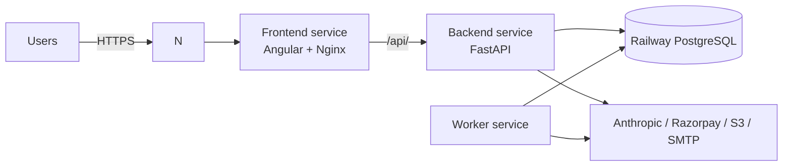

# DentalPilot AI — Railway Deployment Guide

This guide deploys DentalPilot AI to Railway using the repository's actual build and start configuration.

> **Not executed during documentation.** Commands and dashboard paths below reflect the repository's `railway.toml`, `nixpacks.toml`, Dockerfiles and Nginx configs. Verify each step in your Railway project.

---

## 0. What Railway runs today

| Service | Root directory | Build | Start |
|---|---|---|---|
| **Backend** | `products/healthcare/dental/dentalpilot-ai/backend` (or `backend`) | **Nixpacks** (`railway.toml` → `builder = "NIXPACKS"`, `nixpacks.toml` → `python311`) | `alembic upgrade head && uvicorn app.main:app --host 0.0.0.0 --port $PORT` |
| **Worker** | same as backend | same image/build | `python -m app.workers.run_workers` |
| **Frontend** | `products/healthcare/dental/dentalpilot-ai/frontend` (or `frontend`) | **Dockerfile** (`node:20-alpine` → `nginx:alpine`) | Nginx (Dockerfile `CMD`) |
| **Postgres** | Railway-managed | — | — |
| **Redis** | **not used by the app** | — | — |

> Railway uses **Nixpacks** for the backend, not `backend/Dockerfile`. The Dockerfile is used by Docker Compose/GHCR. To switch Railway to the Dockerfile, set `builder = "DOCKERFILE"` in `railway.toml` and align Python versions.



---

## 1. Prerequisites

- A Railway account and a GitHub account with access to `saman2ny/otheryn-platform`.
- The Railway CLI (optional): `npm i -g @railway/cli`, then `railway login`.
- DNS access for `dentalpilot.in` (or your chosen domain).
- Razorpay, Anthropic, SMTP, S3 and WhatsApp credentials for production (optional integrations).

---

## 2. Create the project and connect GitHub

1. Railway → **New Project**.
2. **Deploy from GitHub repo** → select `saman2ny/otheryn-platform`.
3. Railway creates an initial service from the repo root. You will add/repoint services in the next steps.

Dashboard path: **Project → Service → Settings → Source**.

---

## 3. Monorepo service configuration

For each service, set **Settings → Source → Root Directory**:

| Service | Root Directory |
|---|---|
| Backend | `products/healthcare/dental/dentalpilot-ai/backend` |
| Worker | `products/healthcare/dental/dentalpilot-ai/backend` |
| Frontend | `products/healthcare/dental/dentalpilot-ai/frontend` |

If you deploy the standalone DentalPilot repository instead of the monorepo, use `backend` and `frontend`.

**Do not set a Custom Start Command for the backend** — it silently overrides `railway.toml`/`nixpacks.toml`. The backend start command lives in `railway.toml`.

---

## 4. PostgreSQL

1. **New → Database → PostgreSQL**.
2. Railway provisions a private Postgres service.
3. In the backend **Variables**, set `DATABASE_URL`:

```
DATABASE_URL=postgresql+psycopg://${{Postgres.PGUSER}}:${{Postgres.PGPASSWORD}}@${{Postgres.PGHOST}}:${{Postgres.PGPORT}}/${{Postgres.PGDATABASE}}
```

> **Critical:** Railway's `${{Postgres.DATABASE_URL}}` is `postgresql://...`. SQLAlchemy would select `psycopg2`, which is **not installed**. Always use `postgresql+psycopg://`.

4. Use Railway private networking (`postgres.railway.internal`) via the references above. Do not enable public TCP for Postgres.

**Redis:** the application does not use Redis (no client in `requirements.txt`, no `redis` import). Do not add a Redis service unless you implement a Redis-backed feature.

---

## 5. Backend service

1. **New → GitHub Repo →** select the repo; set **Root Directory** to the backend path.
2. **Settings → Build**: leave the builder as `NIXPACKS` (from `railway.toml`). If you prefer Docker, set `builder = "DOCKERFILE"` and ensure the Dockerfile is at the service root.
3. **Settings → Deploy**: confirm the start command is `alembic upgrade head && uvicorn app.main:app --host 0.0.0.0 --port $PORT` (from `railway.toml`). Do not override it in the dashboard.
4. **Variables**:
   - `DATABASE_URL` (see §4)
   - `JWT_SECRET` (32+ random chars)
   - `APP_ENVIRONMENT=production`
   - `CORS_ORIGINS=["https://dentalpilot.in"]`
   - Optional: `ANTHROPIC_API_KEY`, `ANTHROPIC_MODEL`, `RAZORPAY_*`, `S3_*`, `AWS_REGION`, `SMTP_*`, `WHATSAPP_*`
5. **Networking → Generate Domain** (e.g. `api.dentalpilot.in` via CNAME).
6. **Health Check Path**: `/health` (from `railway.toml`).
7. Deploy.

### Backend variable reference

| Variable | Required | Notes |
|---|---|---|
| `DATABASE_URL` | ✅ | `postgresql+psycopg://...` |
| `JWT_SECRET` | ✅ | ≥32 chars, non-default |
| `APP_ENVIRONMENT` | ✅ | `production` |
| `CORS_ORIGINS` | ✅ | JSON array |
| `ANTHROPIC_API_KEY` | Optional | AI content |
| `ANTHROPIC_MODEL` | Optional | Default `claude-opus-4-8` |
| `RAZORPAY_KEY_ID` / `RAZORPAY_KEY_SECRET` | Optional | Must be set together |
| `RAZORPAY_WEBHOOK_SECRET` | Required with Razorpay | Webhook verification |
| `RAZORPAY_PLAN_IDS` | Required with Razorpay | JSON object |
| `PATIENT_PAYMENT_CURRENCY` | Optional | Default `INR` |
| `S3_BUCKET` / `AWS_REGION` / `S3_ENDPOINT_URL` / `S3_KMS_KEY_ID` | Optional | Document storage |
| `MAX_PATIENT_DOCUMENT_BYTES` | Optional | Default `25000000` |
| `SMTP_*` | Optional | Email |
| `WHATSAPP_*` | Optional | WhatsApp |

---

## 6. Worker service

1. **New → GitHub Repo →** same repo; **Root Directory** = backend path.
2. **Settings → Deploy → Custom Start Command**:

```
python -m app.workers.run_workers
```

3. **Variables**: same as the backend (at minimum `DATABASE_URL`, `JWT_SECRET`, `APP_ENVIRONMENT`, plus SMTP/WhatsApp/Razorpay as needed).
4. No public domain.
5. No health check path (the worker has no HTTP server). Railway keeps it running while the process is alive.

The worker uses the **same image/build** as the backend but overrides the startup command.

---

## 7. Frontend service

1. **New → GitHub Repo →** **Root Directory** = frontend path.
2. Railway detects **`frontend/Dockerfile`**.
3. **Settings → Build**: Dockerfile builder; Docker build context = frontend root.
4. **Networking → Generate Domain** (e.g. `dentalpilot.in` / `www.dentalpilot.in` via CNAME).
5. No environment variables are required at runtime.
6. Deploy.

### Build-time API URL

`src/environments/environment.prod.ts` is compiled into the bundle:

```ts
export const environment = {
  production: true,
  apiBaseUrl: 'https://api.dentalpilot.in/api/v1',
};
```

To change the API URL, edit this file **before building**. Railway environment variables do not affect the Angular bundle.

### Nginx

`frontend/nginx.conf` serves the SPA, proxies `/api/` to `https://api.dentalpilot.in`, returns `/health` = `healthy`, and adds security headers.

---

## 8. Domains and TLS

### Backend

1. Railway → backend service → **Settings → Networking → Generate Domain**.
2. Add a **CNAME** for `api.dentalpilot.in` → the Railway hostname.
3. Railway issues TLS automatically once the domain is verified.

### Frontend

1. Generate a Railway domain.
2. Add **CNAME** records for `dentalpilot.in` and `www.dentalpilot.in`.
3. Railway issues TLS automatically.

### Verify

```bash
curl https://api.dentalpilot.in/health
curl https://api.dentalpilot.in/health/ready
curl -I https://dentalpilot.in/health
```

---

## 9. Database migrations

- The backend start command runs `alembic upgrade head` on **every deploy**.
- Do **not** add a separate migration service on Railway; it would duplicate the start command.
- Migrations are **forward-only**. There is no automatic downgrade.
- Before a schema-changing deploy, take a database backup and use backward-compatible (expand/contract) migrations.

```bash
# Inspect the deployed migration state
railway run alembic current
railway run alembic history
```

---

## 10. Build and deployment

### Automatic (recommended)

Push to the connected GitHub branch (`main`). Railway builds and deploys automatically.

### Manual from local code

```bash
railway link
railway up
```

> `railway up` uploads the current directory. Use it only for urgent hotfixes; normal deploys should come from GitHub.

### Check the deployed commit

Railway → service → **Deployments** → deployment card → **Details** → confirm the commit SHA.

---

## 11. Logs

| Log type | Where |
|---|---|
| Build | Railway → service → Deployments → **Build Logs** |
| Runtime | **Deploy Logs** |
| HTTP | **HTTP Logs** |
| CLI | `railway logs` |

```bash
railway logs
railway logs
```

---

## 12. Health checks

| Endpoint | Purpose |
|---|---|
| `GET /health` | Liveness (`{"status":"ok"}`) — used by `railway.toml` `healthcheckPath` |
| `GET /health/live` | Liveness |
| `GET /health/ready` | Readiness; executes `SELECT 1` |

```bash
curl https://api.dentalpilot.in/health
curl https://api.dentalpilot.in/health/ready
```

---

## 13. Backups

- **PostgreSQL:** enable Railway database backups / point-in-time recovery if available. Also take logical backups:

```bash
railway run pg_dump "$DATABASE_URL" > dentalpilot-$(date +%F).sql
```

- **Documents:** S3 bucket versioning + lifecycle + tested restore.
- **Code:** Git history + tags.
- **Secrets:** Railway variables; export to a secure vault; never commit.

---

## 14. Rollbacks

1. Railway → service → **Deployments**.
2. Select the last known-good deployment.
3. **Redeploy**.
4. Confirm the commit in **Details**.
5. Verify `/health/ready`.

> Schema changes are **not** auto-reverted. If a release includes a destructive migration, restore the database from backup or deploy a follow-up migration.

---

## 15. Production security

- **Secrets:** Railway variables only; never in the repo, Dockerfiles, or Compose files.
- **Database:** private networking only; no public TCP.
- **HTTPS:** Railway TLS. HSTS is not set in `nginx.conf`; add it at the edge or in nginx if required.
- **CORS:** explicit origins; no `*`.
- **JWT:** 32+ random secret; rotate periodically.
- **Webhooks:** verify Razorpay signatures; keep `RAZORPAY_WEBHOOK_SECRET` private.
- **Least privilege:** S3 bucket private; app identity limited to required object operations.
- **Audit:** review `audit_events` regularly.
- **Default accounts:** remove/rotate the seeded demo credentials before real use.
- **Rate limiting:** Nginx limits exist for `/api/` and `/api/v1/auth/`; add app-level rate limiting for auth (see audit).

---

## 16. Railway vs VPS vs Docker Compose

| Concern | Railway (this guide) | Docker Compose (`deploy.sh`) | VPS |
|---|---|---|---|
| Build | Nixpacks (backend), Dockerfile (frontend) | GHCR images | Docker images |
| Migrations | Backend start command | One-shot `migrate` service | `deploy.sh` / manual |
| Postgres | Railway-managed | `postgres:16` container | External/managed |
| Redis | Not used | Container (unused) | Optional |
| TLS | Railway automatic | Nginx + mounted certs | Certbot/manual |
| Secrets | Railway variables | `.env.production` | `.env` |
| Rollback | Redeploy previous | Redeploy previous `IMAGE_TAG` | Redeploy previous image |
| Scaling | Railway replicas | Manual | Manual |

---

## 17. Go-live checklist

- [ ] Postgres service created; `DATABASE_URL` uses `postgresql+psycopg://`.
- [ ] Backend root = backend path; no custom start command.
- [ ] `JWT_SECRET` set (32+ chars); `APP_ENVIRONMENT=production`; `CORS_ORIGINS` correct.
- [ ] Worker service running with `python -m app.workers.run_workers`.
- [ ] Frontend root = frontend path; Dockerfile detected; custom domain + TLS.
- [ ] `environment.prod.ts` points at the production API before build.
- [ ] Razorpay webhook URLs configured; `RAZORPAY_WEBHOOK_SECRET` set.
- [ ] S3 bucket private; SMTP/WhatsApp configured if used.
- [ ] `/health` and `/health/ready` return 200.
- [ ] Demo accounts rotated/removed.
- [ ] Backup + rollback procedure tested.
- [ ] Logs and alerts reviewed.

---

## 18. Troubleshooting

| Symptom | Fix |
|---|---|
| Build fails: `No module named pip` | Do not override `[phases.install]` in `nixpacks.toml` (already removed) |
| Build fails: `cd: backend: No such file or directory` | Root directory wrong; do not set a custom start command |
| Runtime: `psycopg2` error | `DATABASE_URL` must be `postgresql+psycopg://` |
| Runtime: `JWT_SECRET` error | Set a 32+ char non-default secret |
| Runtime: `Production requires a managed database` | `DATABASE_URL` is SQLite; use Postgres |
| 502 from frontend | Backend not running / domain wrong; check `/api/` proxy target |
| 404 from frontend `/api/...` | Nginx proxy prefix; the current config preserves `/api/` |
| Old commit deployed | Check Deployments → Details → SHA; reconnect GitHub or `railway up` |
| Worker not sending | Check worker logs; SMTP/WhatsApp vars set |
| Migrations failed | `railway logs`; fix migration; redeploy |

---

## 19. Related documentation

- [`README.md`](README.md) — overview.
- [`ENVIRONMENT_GUIDE.md`](ENVIRONMENT_GUIDE.md) — local vs production.
- [`backend/README.md`](backend/README.md) — backend setup and API.
- [`frontend/README.md`](frontend/README.md) — Angular setup.
- [`DEPLOYMENT.md`](DEPLOYMENT.md) — Docker Compose / VPS.