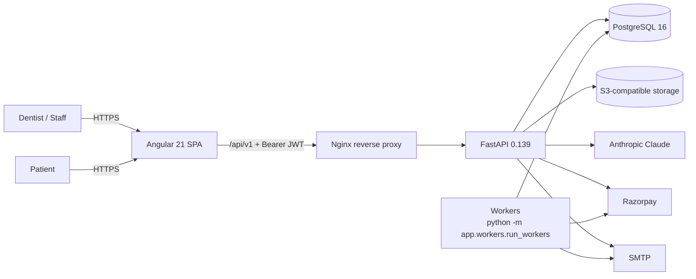

# DentalPilot AI

DentalPilot AI is the first specialty product in the **Otheryn** healthcare intelligence and infrastructure ecosystem. It is an AI-assisted SaaS platform for dental clinics: treatment workflows, a patient portal, clinic operations, marketing content and subscription billing in one application.

> **Status:** v1.2.0 — a working MVP. It is not medical-device certified, not HIPAA/GDPR-certified, and not a live PMS/EHR integration. See [Release boundaries](#release-boundaries) and [`RELEASE_NOTES.md`](RELEASE_NOTES.md).

**Quick links:** [Local Development](#4-local-development) · [Production](#5-production-deployment) · [Documentation](#6-documentation)

**Four authoritative documents:**

1. [`docs/notion/BUSINESS_PROPOSAL.md`](docs/notion/BUSINESS_PROPOSAL.md) — business strategy, market, model and roadmap.
2. [`docs/notion/SETUP_AND_DEPLOYMENT.md`](docs/notion/SETUP_AND_DEPLOYMENT.md) — local development, hot reload and production deployment.
3. [`docs/notion/TECHNICAL_ARCHITECTURE.md`](docs/notion/TECHNICAL_ARCHITECTURE.md) — engineering architecture, API, data, security and testing.
4. [`RELEASE_NOTES.md`](RELEASE_NOTES.md) — version history and release management.

Component guides: [`frontend/README.md`](frontend/README.md) · [`backend/README.md`](backend/README.md). Audit: [`AUDIT/PRODUCT_IMPLEMENTATION_AUDIT.md`](AUDIT/PRODUCT_IMPLEMENTATION_AUDIT.md).

---

## 1. Product Overview

Dentists are clinicians first; administration, patient communication, records, billing and marketing are usually done in the gaps between appointments. DentalPilot AI digitises those workflows:

- **Clinical & practice workflows** — patients, enquiries, visits, treatment plans/stages, a clinic-entered treatment ledger, insurance-claim tracking, records with provenance, consent, recall reminders and audit history.
- **Patient portal** — patients can view their records, download documents and pay their own outstanding treatment charges.
- **Operations** — digital-dentistry case coordination, equipment/maintenance/sterilisation logs, message drafts, marketing publications and clinician note review.
- **Growth & content** — AI-generated marketing content, a content calendar, exports (CSV/PDF/PNG), local-listing audits, campaigns and review drafts.
- **Commerce** — Razorpay subscriptions (Free/Starter/Professional/Enterprise) and Razorpay treatment payments.

### Release boundaries

The 1.2.0 release does **not** claim medical-device approval, legal/compliance certification, or live provider/device interoperability beyond configured Razorpay, S3-compatible storage and SMTP paths. PMS exchange is CSV-only; digital dentistry, equipment, sterilisation, patient messages and marketing publications are manual workflows. Invitations still require secure manual delivery. See [`RELEASE_NOTES.md`](RELEASE_NOTES.md).

### Architecture



- **Frontend:** Angular 21 standalone components, zoneless, signals, Tailwind CSS v4. Served statically by Nginx in production; `ng serve` in development.
- **Backend:** FastAPI (Python 3.12) exposing a versioned REST API under `/api/v1`. SQLAlchemy 2.0 ORM + Alembic migrations.
- **Database:** PostgreSQL 16 in production and in the local Docker stack; SQLite is the zero-setup native default.
- **Workers:** a separate process that polls database-backed outboxes (email, patient communication) and reconciles subscriptions. **Redis is provisioned in Docker Compose but is not consumed by application code** — the queues are database-backed.
- **Integrations:** Anthropic (AI content/notes), Razorpay (subscriptions + treatment payments), SMTP (email), S3-compatible storage with optional AWS KMS, WhatsApp Cloud API adapter.

---

## 2. Technology Stack

| Layer | Technology | Version / note |
|---|---|---|
| Frontend | Angular | `^21.2.0` (standalone, zoneless, signals) |
| Frontend language | TypeScript | `~5.9.2` (strict) |
| Frontend styling | Tailwind CSS | `^4.3.3` |
| Frontend tests | Vitest | `^4.0.8` via `@angular/build:unit-test` |
| Node.js | Node | **20.19+ / 22.12+ / 24.x**; Docker image `node:20-alpine` |
| npm | npm | `11.6.2` (`packageManager`) |
| Backend | FastAPI | `0.139.2` |
| Backend | Python | **3.12** (Docker `python:3.12-slim`; Railway Nixpacks uses `python311`) |
| ORM | SQLAlchemy | `2.0.51` |
| Migrations | Alembic | `1.18.5` |
| Validation | Pydantic | `2.13.4` |
| Server | Uvicorn | `0.51.0` |
| Passwords | bcrypt | `5.0.0` |
| JWT | PyJWT | `2.13.0` |
| AI | Anthropic SDK | `0.117.0` |
| Payments | Razorpay SDK | `2.0.1` |
| Storage | boto3 | `>=1.35,<2.0` |
| Database | PostgreSQL | **16** (production/local Docker); SQLite (native default) |
| Cache/queue | Redis | 7 in Compose — **not used by app code today** |

> **Version verification:** tested locally on Node v24.16.0 / npm 11.20.0 and Python 3.12 (Docker). Deployment uses `node:20-alpine` (floating) and Railway Nixpacks `python311` (3.11) — see [`docs/notion/SETUP_AND_DEPLOYMENT.md`](docs/notion/SETUP_AND_DEPLOYMENT.md) §A.1.

---

## 3. Prerequisites

- **Docker** 24+ with **Docker Compose v2** (`docker compose`, not `docker-compose`).
- **Node.js** 22 LTS recommended (20.19+ minimum) and **npm 11**.
- **Python 3.12** (Python 3.14 may lack wheels for the pinned dependencies).
- **Git**.
- **8 GB RAM** minimum for Docker/Angular builds.
- **Ports:** `4200` (Angular), `8000` (FastAPI), `5432` (Postgres), `6379` (Redis).

---

## 4. Local Development

Docker Compose runs PostgreSQL, Redis, migrations, the FastAPI backend and the workers. The Angular frontend runs natively with `ng serve` (or in a Node container).

```bash
cd products/healthcare/dental/dentalpilot-ai
cp .env.local.example .env.local
# Edit .env.local: POSTGRES_PASSWORD, JWT_SECRET, DATABASE_URL (host `postgres`)

docker compose -f docker-compose.local.yml up -d --build

cd frontend
npm ci
npm start
```

| Service | URL / port |
|---|---|
| Angular dev server | <http://localhost:4200> |
| FastAPI | <http://localhost:8000> |
| Swagger UI | <http://localhost:8000/docs> |
| Health | <http://localhost:8000/health> |
| Readiness | <http://localhost:8000/health/ready> |
| PostgreSQL | `localhost:5432` (container `dentalpilot-local-postgres`) |
| Redis | `localhost:6379` (provisioned but **not used by app code**) |

> **Full local instructions** — Docker/native setup, hot reload for Angular/FastAPI/workers, PostgreSQL/SQLite/Redis, startup/shutdown, logs, rebuilds and troubleshooting: [`docs/notion/SETUP_AND_DEPLOYMENT.md`](docs/notion/SETUP_AND_DEPLOYMENT.md).

---

## 5. Production Deployment

Production runs on **Railway** with four managed services: **frontend**, **backend**, **worker** and **PostgreSQL**. Redis is not used.

| Service | Root (monorepo) | Build | Start command | Public |
|---|---|---|---|---|
| **Backend** | `products/healthcare/dental/dentalpilot-ai/backend` | **Nixpacks** (`railway.toml`) | `alembic upgrade head && uvicorn app.main:app --host 0.0.0.0 --port $PORT` | `api.dentalpilot.in` |
| **Worker** | `products/healthcare/dental/dentalpilot-ai/backend` | same as backend | `python -m app.workers.run_workers` | none |
| **Frontend** | `products/healthcare/dental/dentalpilot-ai/frontend` | **Dockerfile** (`node:20-alpine` → `nginx:alpine`) | Nginx (Dockerfile `CMD`) | custom domain |
| **PostgreSQL** | Railway-managed | — | — | private only |

Key rules:

- **No Uvicorn `--reload` in production.**
- **No Angular dev server in production.**
- **Frontend API URL is build-time** (`src/environments/environment.prod.ts`); **backend config is runtime** (Railway variables).
- **`DATABASE_URL` must use `postgresql+psycopg://`** (not Railway's `postgresql://`).
- **No development secrets in production.**

> **Full production instructions** — service-by-service Railway setup, domains, TLS, migrations, backups, rollbacks and security: [`docs/notion/SETUP_AND_DEPLOYMENT.md`](docs/notion/SETUP_AND_DEPLOYMENT.md).

---

## 6. Documentation

| Document | Responsibility |
|---|---|
| [`docs/notion/BUSINESS_PROPOSAL.md`](docs/notion/BUSINESS_PROPOSAL.md) | Business strategy, market, business model, roadmap |
| [`docs/notion/SETUP_AND_DEPLOYMENT.md`](docs/notion/SETUP_AND_DEPLOYMENT.md) | Local development, hot reload, production deployment, environment variables |
| [`docs/notion/TECHNICAL_ARCHITECTURE.md`](docs/notion/TECHNICAL_ARCHITECTURE.md) | Engineering architecture, API, database, security, testing |
| [`RELEASE_NOTES.md`](RELEASE_NOTES.md) | Version history and release management |
| [`frontend/README.md`](frontend/README.md) | Frontend component guide |
| [`backend/README.md`](backend/README.md) | Backend component guide |
| [`AUDIT/PRODUCT_IMPLEMENTATION_AUDIT.md`](AUDIT/PRODUCT_IMPLEMENTATION_AUDIT.md) | Evidence-based product audit |

---

## Appendix A — Repository structure

```
products/healthcare/dental/dentalpilot-ai/
├── README.md
├── RELEASE_NOTES.md
├── docker-compose.yml
├── docker-compose.local.yml
├── docker-compose.staging.yml
├── deploy.sh
├── .env.local.example
├── .env.staging.example
├── .env.production.example
├── .gitignore
├── nginx/
├── frontend/                  # Angular 21 application
├── backend/                   # FastAPI application + workers
├── AUDIT/                     # product implementation audit
└── docs/notion/
    ├── BUSINESS_PROPOSAL.md
    ├── SETUP_AND_DEPLOYMENT.md
    ├── TECHNICAL_ARCHITECTURE.md
    └── archive/               # original 01–03 (historical)
```

## Appendix B — Frontend and backend responsibilities

| Concern | Frontend | Backend |
|---|---|---|
| UI / routing / forms | ✅ Angular standalone components, signals, Tailwind | ❌ |
| Validation | Client-side hints only | ✅ Pydantic schemas, server-side authority |
| Auth | Stores JWT in `localStorage`, attaches `Authorization` | ✅ bcrypt, JWT, roles |
| Tenant isolation | Sends the token only | ✅ `clinic_id`/`branch_id` filters |
| Business rules | None | ✅ Treatment, ledger, claims, consent, recalls, billing |
| Persistence | ❌ | ✅ SQLAlchemy + Alembic |
| Background work | ❌ | ✅ DB-backed outbox workers |
| File storage | Requests upload/download | ✅ S3-compatible, presigned, audited |
| AI / payments | Opens Razorpay checkout, calls API | ✅ Anthropic, Razorpay verification, SMTP |

## Appendix C — Frontend/backend communication

- **Base URL:** `/api/v1` (dev `http://localhost:8000/api/v1`, prod `https://api.dentalpilot.in/api/v1`).
- **Format:** JSON, camelCase.
- **Auth:** `Authorization: Bearer <accessToken>`.
- **Errors:** `{ "statusCode": number, "message": string, "errors"?: { field: string[] } }`.
- **CORS:** `CORS_ORIGINS` JSON array; credentials enabled.
- **Contract:** [`frontend/src/app/core/constants/api-endpoints.const.ts`](frontend/src/app/core/constants/api-endpoints.const.ts).

## Appendix D — Database and authentication

- **Engine:** SQLAlchemy 2.0, `SessionLocal`, `get_db()` per request.
- **URL:** `DATABASE_URL` (SQLite default; Postgres `postgresql+psycopg://`).
- **Migrations:** Alembic, 12 linear revisions, single head `e78cbd0fad9c`.
- **Tenancy:** indexed `clinic_id` on tenant tables; staff scoped by `branch_id`.
- **Tokens:** access 30 min, refresh 30 days, patient access 15 min.
- **Passwords:** bcrypt with 72-byte truncation.
- **Known limitations:** logout is stateless, tokens in `localStorage`, no refresh rotation, forgot-password is a no-op.

## Appendix E — Testing

```bash
# Backend
cd backend && source .venv/bin/activate && pytest tests/ -q

# Frontend
cd frontend && npm test

# Formatting
cd frontend && npx prettier --check "src/**/*.{ts,html,css}"
```

## Appendix F — Business model

Subscription SaaS (Free / Starter / Professional / Enterprise), billed monthly or annually via Razorpay. Treatment payments are separate patient charges, not subscription revenue.