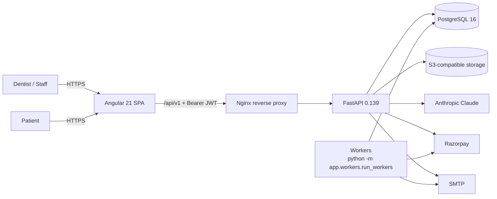
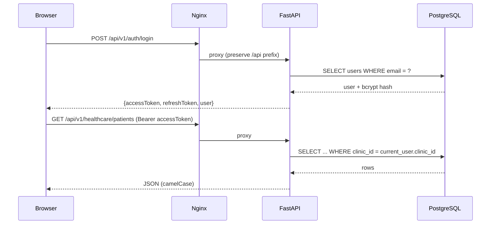
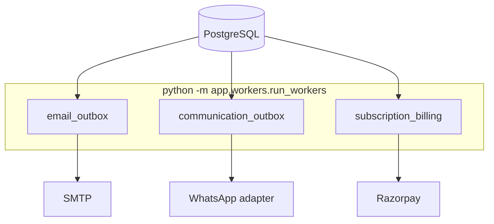

# DentalPilot AI

DentalPilot AI is the first specialty product in the **Otheryn** healthcare intelligence and infrastructure ecosystem. It is an AI-assisted SaaS platform for dental clinics: treatment workflows, a patient portal, clinic operations, marketing content, and subscription billing in one application.

> **Status:** v1.2.0 — a working MVP. It is not medical-device certified, not HIPAA/GDPR-certified, and not a live PMS/EHR integration. See [Release boundaries](#release-boundaries).

---

## 1. Product overview

Dentists are clinicians first; administration, patient communication, records, billing and marketing are usually done in the gaps between appointments. DentalPilot AI digitises those workflows:

- **Clinical & practice workflows** — patients, enquiries, visits, treatment plans/stages, a clinic-entered treatment ledger, insurance-claim tracking, records with provenance, consent, recall reminders, and audit history.
- **Patient portal** — patients can view their records, download documents, and pay their own outstanding treatment charges.
- **Operations** — digital-dentistry case coordination, equipment/maintenance/sterilisation logs, message drafts, marketing publications, and clinician note review.
- **Growth & content** — AI-generated marketing content, a content calendar, exports (CSV/PDF/PNG), local-listing audits, campaigns, and review drafts.
- **Commerce** — Razorpay subscriptions (Free/Starter/Professional/Enterprise) and Razorpay treatment payments.

### Release boundaries

The 1.2.0 release does **not** claim medical-device approval, legal/compliance certification, or live provider/device interoperability beyond configured Razorpay, S3-compatible storage and SMTP paths. PMS exchange is CSV-only; digital dentistry, equipment, sterilisation, patient messages and marketing publications are manual workflows. Invitations still require secure manual delivery. See [`RELEASE_NOTES.md`](RELEASE_NOTES.md).

---

## 2. Application architecture



- **Frontend:** Angular 21 standalone components, zoneless, signals, Tailwind CSS v4. Served statically by Nginx in production; `ng serve` in development.
- **Backend:** FastAPI (Python 3.12) exposing a versioned REST API under `/api/v1`. SQLAlchemy 2.0 ORM + Alembic migrations.
- **Database:** PostgreSQL 16 in production and in the local Docker stack; SQLite is the zero-setup native default.
- **Workers:** a separate process that polls database-backed outboxes (email, patient communication) and reconciles subscriptions. **Redis is provisioned in Docker Compose but is not currently consumed by the application code** — the queues are database-backed.
- **Integrations:** Anthropic (AI content/notes), Razorpay (subscriptions + treatment payments), SMTP (email), S3-compatible storage with optional AWS KMS, WhatsApp Cloud API adapter.

### Request flow



---

## 3. Technology stack and versions

| Layer | Technology | Version / note |
|---|---|---|
| Frontend | Angular | `^21.2.0` (standalone, zoneless, signals) |
| Frontend language | TypeScript | `~5.9.2` (strict) |
| Frontend styling | Tailwind CSS | `^4.3.3` |
| Frontend tests | Vitest | `^4.0.8` via `@angular/build:unit-test` |
| Node.js | Node | **20.19+ / 22.12+ / 24.x** (Angular 21 requirement); Docker image `node:20-alpine` |
| npm | npm | `11.6.2` (`packageManager`) |
| Backend | FastAPI | `0.139.2` |
| Backend | Python | **3.12** (Docker `python:3.12-slim`; `railway.toml` uses Nixpacks `python311`) |
| ORM | SQLAlchemy | `2.0.51` |
| Migrations | Alembic | `1.18.5` |
| Validation | Pydantic | `2.13.4` |
| Server | Uvicorn | `0.51.0` |
| Passwords | bcrypt | `5.0.0` |
| JWT | PyJWT | `2.13.0` |
| AI | Anthropic SDK | `0.117.0` |
| Payments | Razorpay SDK | `2.0.1` |
| Storage | boto3 | `>=1.35,<2.0` |
| Database | PostgreSQL | **16** (production/local Docker); SQLite (native default) |
| Cache/queue | Redis | 7 in Compose — **not used by app code today** |

---

## 4. System requirements

- **Docker** 24+ with **Docker Compose v2** (`docker compose`, not `docker-compose`) — for the Postgres local stack and production images.
- **Node.js** 22 LTS recommended (20.19+ minimum) and **npm 11** — for the Angular frontend.
- **Python 3.12** — for native backend development (Python 3.14 may lack wheels for the pinned dependencies).
- **Git** — clone from the parent `otheryn-platform` repository.
- **8 GB RAM** minimum for Docker builds (Angular production builds are memory-hungry).
- **Ports:** `4200` (Angular dev server), `8000` (FastAPI), `5432` (Postgres), `6379` (Redis).

---

## 5. Repository directory structure

```
products/healthcare/dental/dentalpilot-ai/
├── README.md                  # this file — start here
├── ENVIRONMENT_GUIDE.md       # local vs staging vs production
├── RAILWAY_DEPLOYMENT.md      # Railway service-by-service guide
├── CONTRIBUTING.md            # workflow and conventions
├── DEPLOYMENT.md              # Docker Compose / VPS deployment
├── RELEASE_NOTES.md           # 1.2.0 implemented scope and boundaries
├── docker-compose.yml         # production stack (GHCR images)
├── docker-compose.local.yml   # local Postgres + Redis + backend + workers
├── docker-compose.staging.yml # staging overrides
├── deploy.sh                  # production/staging helper script
├── .env.local.example         # local env template
├── .env.staging.example       # staging env template
├── .env.production.example    # production env template
├── .gitignore
├── nginx/
│   ├── conf.d/default.conf    # production HTTPS + API proxy
│   └── staging/default.conf   # staging HTTP-only
├── frontend/                  # Angular 21 application
├── backend/                   # FastAPI application
├── AUDIT/                     # product implementation audit
└── docs/                      # Notion exports / internal notes
```

Each application has its own README:

- [`frontend/README.md`](frontend/README.md) — Angular developers.
- [`backend/README.md`](backend/README.md) — Python/FastAPI developers.

---

## 6. Frontend and backend responsibilities

| Concern | Frontend (`frontend/`) | Backend (`backend/`) |
|---|---|---|
| UI / routing / forms | ✅ Angular standalone components, signals, Tailwind | ❌ |
| Validation | Client-side hints only | ✅ Zod-equivalent Pydantic schemas, server-side authority |
| Auth | Stores JWT in `localStorage`, attaches `Authorization` header | ✅ bcrypt hashing, JWT access/refresh/patient tokens, role checks |
| Tenant isolation | Sends the caller's token only | ✅ `clinic_id`/`branch_id` filters on every query |
| Business rules | None | ✅ Treatment stages, ledger, claims, consent, recalls, billing |
| Persistence | ❌ | ✅ SQLAlchemy ORM + Alembic |
| Background work | ❌ | ✅ DB-backed outbox workers |
| File storage | Requests upload/download | ✅ S3-compatible, presigned, audited |
| AI / payments | Opens Razorpay checkout, calls API | ✅ Anthropic, Razorpay verification, SMTP |

---

## 7. Frontend/backend communication

- **Base URL:** `/api/v1` (dev `http://localhost:8000/api/v1`, prod `https://api.dentalpilot.in/api/v1`).
- **Format:** JSON, **camelCase** (Pydantic `CamelModel` converts to/from snake_case).
- **Auth:** `Authorization: Bearer <accessToken>`; the `authInterceptor` attaches it automatically for API requests.
- **Errors:** `{ "statusCode": number, "message": string, "errors"?: { field: string[] } }`.
- **CORS:** explicit origins from `CORS_ORIGINS` (JSON array); credentials enabled; `Content-Disposition` exposed for downloads.
- **Contract:** [`frontend/src/app/core/constants/api-endpoints.const.ts`](frontend/src/app/core/constants/api-endpoints.const.ts) mirrors the backend routers.

---

## 8. Database architecture

- **Engine:** SQLAlchemy 2.0, one `SessionLocal`, `get_db()` dependency per request.
- **URL:** `DATABASE_URL`. Default `sqlite:///./dentalpilot.db`; production `postgresql+psycopg://...` (the `+psycopg` driver is required).
- **Migrations:** Alembic, 12 linear revisions, single head `e78cbd0fad9c` (at the time of writing).
- **Core tables:** `users`, `clinics`, `clinic_branches`, `patients`, `patient_enquiries`, `patient_visits`, `treatment_plans`, `treatment_stages`, `treatment_decisions`, `treatment_ledger_entries`, `insurance_claims`, `health_records`, `health_record_revisions`, `record_consents`, `patient_record_shares`, `recall_reminders`, `email_outbox`, `communication_templates`, `patient_communications`, `communication_outbox`, `audit_events`, `dental_workflow_cases`, `clinic_assets`, `clinical_note_drafts`, `clinic_subscriptions`, `invoices`, `billing_webhook_events`, `patient_payment_orders`, `clinic_organizations`, `organization_members`.
- **Tenancy:** nearly every tenant table has an indexed `clinic_id`; staff may be further scoped by `branch_id`.
- **Idempotency:** unique `provider_event_id` (billing webhooks), unique `charge_entry_id` (patient payment orders), unique `reminder_id` (email outbox).

> **Never point a local `.env` at a production database.** See [`ENVIRONMENT_GUIDE.md`](ENVIRONMENT_GUIDE.md).

---

## 9. Authentication and authorization

| Token | Lifetime | Used for |
|---|---|---|
| Access | 30 min (`ACCESS_TOKEN_EXPIRE_MINUTES`) | API calls (`Authorization: Bearer`) |
| Refresh | 30 days (`REFRESH_TOKEN_EXPIRE_DAYS`) | Obtaining a new access token (`POST /auth/refresh`) |
| Patient access | 15 min | Patient-portal endpoints |

- Passwords: bcrypt, with explicit 72-byte truncation (`app/core/security.py`).
- Roles: `super_admin`, `owner`, `staff`; organisation roles `organization_owner`, `organization_admin`, `organization_reporting`.
- **Known limitations:** logout is stateless (no revocation), tokens are stored in `localStorage`, and there is no refresh-token rotation or password-reset email yet. See [`backend/README.md`](backend/README.md#j-known-limitations).

---

## 10. Background worker architecture



- Entry point: `python -m app.workers.run_workers` (three threads).
- **Email outbox:** claims pending `email_outbox` rows, sends via SMTP, capped exponential backoff, stops at `EMAIL_MAX_ATTEMPTS`.
- **Communication outbox:** same pattern for patient email/SMS/WhatsApp drafts.
- **Subscription billing:** processes stored Razorpay webhook events, renewals, failures, grace periods, cancellations, and dunning.
- The workers are **database-backed**; Redis is not used.
- Run them as a **separate service** (Railway worker service or Compose `workers` service). Do not rely on the web process.

---

## 11. External integrations

| Integration | Status | Configuration | Failure behaviour |
|---|---|---|---|
| Anthropic Claude | Implemented | `ANTHROPIC_API_KEY`, `ANTHROPIC_MODEL` | 503 with a clear message when unset |
| Razorpay subscriptions | Implemented | `RAZORPAY_KEY_ID`, `RAZORPAY_KEY_SECRET`, `RAZORPAY_WEBHOOK_SECRET`, `RAZORPAY_PLAN_IDS` | 503 when unconfigured; webhooks signed |
| Razorpay treatment payments | Implemented | same keys + `PATIENT_PAYMENT_CURRENCY` | 503 when unconfigured |
| SMTP email | Implemented | `SMTP_HOST`, `SMTP_PORT`, `SMTP_USERNAME`, `SMTP_PASSWORD`, `SMTP_SENDER_EMAIL`, TLS mode | Outbox retries; 503 when unconfigured |
| S3-compatible storage | Implemented | `S3_BUCKET`, `AWS_REGION`, optional `S3_ENDPOINT_URL`, `S3_KMS_KEY_ID` | Uploads return 503 when unconfigured |
| WhatsApp Cloud API | Adapter implemented | `WHATSAPP_PHONE_NUMBER_ID`, `WHATSAPP_ACCESS_TOKEN`, `WHATSAPP_WEBHOOK_VERIFY_TOKEN` | Outbox retries |
| Redis | **Not used by app code** | — | — |

---

## 12. Local development quick start

Two supported paths. **Docker Compose is recommended** because it gives you the same PostgreSQL 16 the production app uses.

### Option A — Docker Compose (PostgreSQL + Redis + backend + workers)

```bash
cd products/healthcare/dental/dentalpilot-ai

cp .env.local.example .env.local
# Edit .env.local:
#   POSTGRES_PASSWORD=<local password>
#   JWT_SECRET=<openssl rand -base64 48>
#   DATABASE_URL=postgresql+psycopg://dentalpilot:<same password>@postgres:5432/dentalpilot

docker compose -f docker-compose.local.yml up -d --build
docker compose -f docker-compose.local.yml ps
```

Then start the frontend in a second terminal:

```bash
cd frontend
npm install
npm start          # http://localhost:4200
```

- API: <http://localhost:8000>
- Swagger UI: <http://localhost:8000/docs>
- Health: <http://localhost:8000/health>
- Frontend: <http://localhost:4200>

Stop / restart / logs:

```bash
docker compose -f docker-compose.local.yml stop
docker compose -f docker-compose.local.yml restart backend workers
docker compose -f docker-compose.local.yml logs -f backend workers
docker compose -f docker-compose.local.yml down          # keep volumes
docker compose -f docker-compose.local.yml down -v       # DESTRUCTIVE: deletes local DB/Redis data
```

### Option B — Native (SQLite, no Docker)

```bash
cd backend
python3.12 -m venv .venv
source .venv/bin/activate
pip install -r requirements.txt

cp .env.example .env
# Edit .env: set JWT_SECRET to a long random string.

alembic upgrade head
python scripts/seed_hierarchy.py
uvicorn app.main:app --reload --port 8000
```

In a second terminal, run the workers:

```bash
cd backend
source .venv/bin/activate
python -m app.workers.run_workers
```

In a third terminal, run the frontend:

```bash
cd frontend
npm install
npm start
```

> **Known SQLite issue:** `alembic upgrade head` on SQLite may fail at revision `e78cbd0fad9c` with `ValueError: Constraint must have a name`. If you hit this, use Option A (PostgreSQL) or apply the named-constraint fix. See [`backend/README.md`](backend/README.md#i-troubleshooting).

### Demo accounts (local only)

`python scripts/seed_hierarchy.py` creates one demo clinic and three users. Password for all: `password123`.

| Role | Email |
|---|---|
| Super Admin | `super-admin@dentalpilot.ai` |
| Clinic Owner | `owner@brightsmiledental.io` |
| Clinic Staff | `staff@brightsmiledental.io` |

**Do not use these credentials in staging or production.**

---

## 13. Railway production deployment (overview)

Production runs on Railway:

- **Backend:** `api.dentalpilot.in` — Railway service, root directory `backend`, built with **Nixpacks** (`railway.toml`), start command `alembic upgrade head && uvicorn app.main:app --host 0.0.0.0 --port $PORT`.
- **Worker:** separate Railway service using the same repo/root, start command `python -m app.workers.run_workers`.
- **Frontend:** static Angular build served by Nginx (Dockerfile), pointing at `https://api.dentalpilot.in/api/v1` (build-time).
- **Postgres:** Railway-managed PostgreSQL.
- **Redis:** not currently used by the app.

See [`RAILWAY_DEPLOYMENT.md`](RAILWAY_DEPLOYMENT.md) for the full service-by-service guide and [`ENVIRONMENT_GUIDE.md`](ENVIRONMENT_GUIDE.md) for local vs production separation.

---

## 14. Testing

```bash
# Backend (from backend/, venv active)
pytest tests/ -q

# Frontend (from frontend/)
npm test

# Formatting check (no lint script exists)
npx prettier --check "src/**/*.{ts,html,css}"
```

Backend tests cover healthcare workflows, native operations/organizations, and the email outbox. See [`backend/README.md`](backend/README.md#b6-run-tests) and [`frontend/README.md`](frontend/README.md#b6-tests).

---

## 15. Troubleshooting

| Symptom | First check |
|---|---|
| `npm install` fails | Node 20.19+/22.12+/24 and npm 11; delete `node_modules` + `package-lock.json` only if you intend to re-resolve |
| `ng serve` cannot reach API | Backend on `:8000`; `CORS_ORIGINS` includes `http://localhost:4200` |
| `alembic upgrade head` fails on SQLite | Use Docker Compose Postgres (Option A); see backend troubleshooting |
| `503` from AI/payments/storage | The corresponding API key/bucket is not configured — expected |
| Login works but API calls 401 | Access token expired (30 min); re-login; refresh is not automatic |
| Port already in use | `lsof -i :8000` / `lsof -i :4200` |

Full guides: [`frontend/README.md`](frontend/README.md#f-frontend-troubleshooting), [`backend/README.md`](backend/README.md#i-troubleshooting), [`ENVIRONMENT_GUIDE.md`](ENVIRONMENT_GUIDE.md).

---

## 16. Documentation map

| Document | Audience |
|---|---|
| [`frontend/README.md`](frontend/README.md) | Angular developers |
| [`backend/README.md`](backend/README.md) | Python/FastAPI developers |
| [`ENVIRONMENT_GUIDE.md`](ENVIRONMENT_GUIDE.md) | Everyone — local vs staging vs production |
| [`RAILWAY_DEPLOYMENT.md`](RAILWAY_DEPLOYMENT.md) | DevOps / deployers |
| [`DEPLOYMENT.md`](DEPLOYMENT.md) | Docker Compose / VPS deployers |
| [`CONTRIBUTING.md`](CONTRIBUTING.md) | Contributors |
| [`RELEASE_NOTES.md`](RELEASE_NOTES.md) | Product scope and boundaries |
| [`AUDIT/PRODUCT_IMPLEMENTATION_AUDIT.md`](AUDIT/PRODUCT_IMPLEMENTATION_AUDIT.md) | Architecture/QA audit |

---

## 17. Business model

Subscription SaaS (Free / Starter / Professional / Enterprise), billed monthly or annually via Razorpay. Treatment payments are separate patient charges, not subscription revenue.