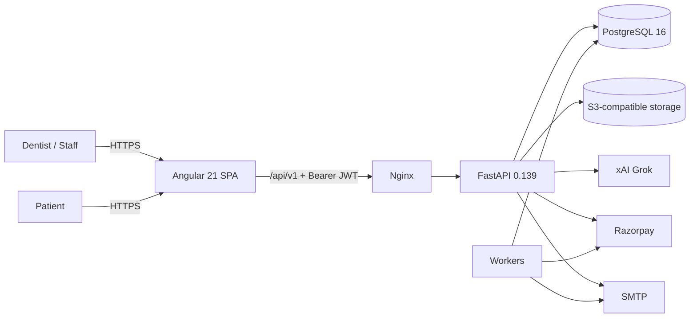

# DentalPilot AI

DentalPilot AI is the first specialty product in the **Otheryn** healthcare intelligence and infrastructure ecosystem. It is an AI-assisted SaaS platform for dental clinics: treatment workflows, a patient portal, clinic operations, marketing content and subscription billing in one application.

> **Status:** v1.2.0 — a working MVP. Not medical-device certified, not HIPAA/GDPR-certified, and not a live PMS/EHR integration. See [Release boundaries](#release-boundaries) and [`RELEASE_NOTES.md`](RELEASE_NOTES.md).

**Docs:** [Setup & Deployment](docs/notion/SETUP_AND_DEPLOYMENT.md) · [Architecture](docs/notion/TECHNICAL_ARCHITECTURE.md) · [Business Proposal](docs/notion/BUSINESS_PROPOSAL.md) · [Release Notes](RELEASE_NOTES.md) · [Contributing](CONTRIBUTING.md)

---

## 1. Product Overview

- **Clinical & practice workflows** — patients, enquiries, visits, treatment plans/stages, treatment ledger, insurance-claim tracking, records with provenance, consent, recall reminders, audit history.
- **Patient portal** — records, downloads, expiring shares, self-service treatment payments.
- **Operations** — digital-dentistry case coordination, assets/maintenance, sterilisation logs, message/publication drafts, clinician note review.
- **Growth & content** — AI-generated marketing content, calendar, exports (CSV/PDF/PNG), local-listing audits, campaigns, review drafts.
- **Commerce** — Razorpay subscriptions (Free/Starter/Professional/Enterprise) and Razorpay treatment payments.

### Release boundaries

1.2.0 does **not** claim medical-device approval, compliance certification, or live provider/device interoperability beyond configured Razorpay, S3-compatible storage and SMTP paths. PMS exchange is CSV-only; digital dentistry, equipment, sterilisation, patient messages and marketing publications are manual workflows. Invitations require secure manual delivery. See [`RELEASE_NOTES.md`](RELEASE_NOTES.md).

### Architecture



Full architecture, data model, security and deployment design: [`docs/notion/TECHNICAL_ARCHITECTURE.md`](docs/notion/TECHNICAL_ARCHITECTURE.md).

---

## 2. Local Development (Docker only)

**Prerequisites:** Docker Desktop 24+ with Compose v2. No host Node.js, npm, Python, pip, PostgreSQL or Redis required.

```bash
cd products/healthcare/dental/dentalpilot-ai
cp .env.local.example .env.local
# Edit .env.local: POSTGRES_PASSWORD, JWT_SECRET, DATABASE_URL (host `postgres`)

docker compose -f docker-compose.local.yml up -d --build
```

This starts PostgreSQL 16, a one-shot Alembic migration, the FastAPI backend (hot reload), the background workers and the Angular dev server (HMR).

| Service | URL / port |
|---|---|
| Angular dev server | <http://localhost:4200> |
| FastAPI | <http://localhost:8000> |
| Swagger UI | <http://localhost:8000/docs> |
| Health | <http://localhost:8000/health> |
| Readiness | <http://localhost:8000/health/ready> |
| PostgreSQL | `localhost:5432` |

Full local guide (hot reload, database, workers, Docker operations, troubleshooting): [`docs/notion/SETUP_AND_DEPLOYMENT.md`](docs/notion/SETUP_AND_DEPLOYMENT.md).

---

## 3. Production Deployment

Production runs on **Railway** (managed) or **Docker Compose VPS**. It uses a static Angular build + Nginx, FastAPI without reload, a separate worker service and PostgreSQL 16.

| Service | Railway | Compose VPS |
|---|---|---|
| Frontend | Dockerfile (`node:20-alpine` → `nginx:alpine`) | GHCR `frontend` image |
| Backend | Nixpacks (`railway.toml`) | GHCR `backend` image |
| Worker | same image, `python -m app.workers.run_workers` | same image, custom command |
| PostgreSQL | Railway PostgreSQL | `postgres:16-alpine` |
| Redis | **not used** | **not used** |

Key rules: no `--reload` in production; frontend API URL is build-time (`environment.prod.ts`); backend config is runtime; `DATABASE_URL` must use `postgresql+psycopg://`; no development secrets.

Full production guide (Railway, Compose VPS, Nginx, SSL, migrations, backups, rollback, security): [`docs/notion/SETUP_AND_DEPLOYMENT.md`](docs/notion/SETUP_AND_DEPLOYMENT.md).

---

## 4. Architecture

See [`docs/notion/TECHNICAL_ARCHITECTURE.md`](docs/notion/TECHNICAL_ARCHITECTURE.md) for the system overview, frontend/backend architecture, API, database/ER model, authentication, multi-tenancy, workers, integrations, security, testing and deployment architecture.

---

## 5. Business Proposal

See [`docs/notion/BUSINESS_PROPOSAL.md`](docs/notion/BUSINESS_PROPOSAL.md) for the market, business model, roadmap and strategy.

---

## 6. Release Notes

See [`RELEASE_NOTES.md`](RELEASE_NOTES.md) for the 1.2.0 implemented scope, remaining items and release boundary.

---

## 7. Documentation map

| Document | Audience |
|---|---|
| [`docs/notion/SETUP_AND_DEPLOYMENT.md`](docs/notion/SETUP_AND_DEPLOYMENT.md) | Developers & DevOps — local Docker, staging, production, environment variables |
| [`docs/notion/TECHNICAL_ARCHITECTURE.md`](docs/notion/TECHNICAL_ARCHITECTURE.md) | Engineers — architecture |
| [`docs/notion/BUSINESS_PROPOSAL.md`](docs/notion/BUSINESS_PROPOSAL.md) | Business — strategy |
| [`RELEASE_NOTES.md`](RELEASE_NOTES.md) | Everyone — version history |
| [`CONTRIBUTING.md`](CONTRIBUTING.md) | Contributors |
| [`frontend/README.md`](frontend/README.md) | Frontend developers |
| [`backend/README.md`](backend/README.md) | Backend developers |
| [`AUDIT/PRODUCT_IMPLEMENTATION_AUDIT.md`](AUDIT/PRODUCT_IMPLEMENTATION_AUDIT.md) | Architecture/QA audit |

---

## Appendix — Technology stack

| Layer | Technology |
|---|---|
| Frontend | Angular 21, TypeScript 5.9, Tailwind CSS 4, Vitest |
| Backend | FastAPI 0.139, Python 3.12, SQLAlchemy 2.0, Alembic, Pydantic 2 |
| Database | PostgreSQL 16 (SQLite for native only) |
| AI | xAI Grok (OpenAI-compatible, `grok-4.7`) |
| Payments | Razorpay |
| Storage | S3-compatible + optional AWS KMS |
| Containers | Docker, Docker Compose, Nginx |