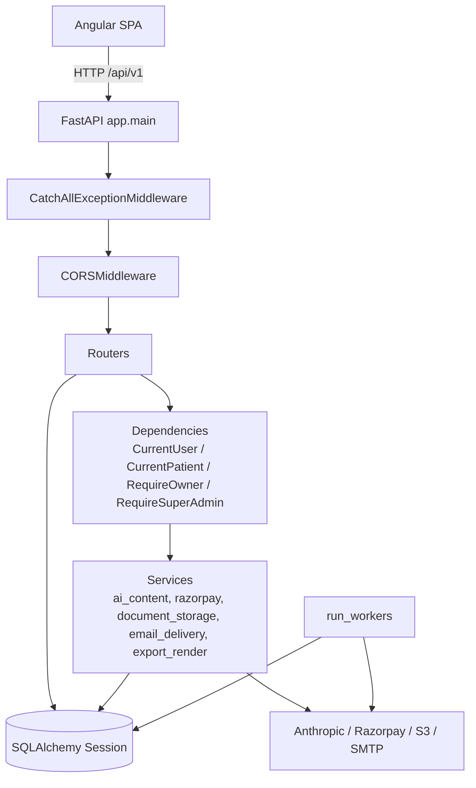

# DentalPilot AI — Backend

FastAPI application implementing the REST contract consumed by the Angular frontend. It owns authentication, tenant isolation, business rules, persistence, background work and all external integrations.

> Frontend contract: [`../frontend/src/app/core/constants/api-endpoints.const.ts`](../frontend/src/app/core/constants/api-endpoints.const.ts)
> Environment guide: [`../ENVIRONMENT_GUIDE.md`](../ENVIRONMENT_GUIDE.md)
> Railway guide: [`../RAILWAY_DEPLOYMENT.md`](../RAILWAY_DEPLOYMENT.md)

---

## A. Backend overview

### A.1 Versions

| Component | Version |
|---|---|
| Python | **3.12** (Docker `python:3.12-slim`; Railway Nixpacks uses `python311`) |
| FastAPI | `0.139.2` |
| Starlette | `1.3.1` |
| Pydantic | `2.13.4` |
| SQLAlchemy | `2.0.51` |
| Alembic | `1.18.5` |
| Uvicorn | `0.51.0` |
| bcrypt | `5.0.0` |
| PyJWT | `2.13.0` |
| Anthropic SDK | `0.117.0` |
| Razorpay SDK | `2.0.1` |
| boto3 | `>=1.35,<2.0` |
| reportlab | `5.0.0` |
| Pillow | `12.3.0` |
| pytest | `9.0.2` |

### A.2 Responsibilities

- **Auth:** bcrypt password hashing, JWT access/refresh/patient tokens, role and branch checks.
- **Tenancy:** every tenant query is scoped by `current_user.clinic_id` (and `branch_id` for staff).
- **Business logic:** patients, enquiries, visits, treatment plans/stages/decisions, ledger, insurance claims, records/revisions, consents, recalls, communications, operations, organizations, growth, billing.
- **Persistence:** SQLAlchemy 2.0 ORM, Alembic migrations, PostgreSQL/SQLite.
- **Background work:** database-backed outboxes (email, patient communication) and subscription reconciliation.
- **Integrations:** Anthropic, Razorpay, SMTP, S3-compatible storage, WhatsApp adapter.

### A.3 Architecture



### A.4 Directory structure

```
backend/
├── app/
│   ├── main.py              # FastAPI app, middleware, routers, health
│   ├── core/
│   │   ├── config.py        # Pydantic Settings (env vars)
│   │   ├── database.py      # engine, SessionLocal, Base, get_db
│   │   ├── deps.py          # CurrentUser, CurrentPatient, RequireOwner, RequireSuperAdmin
│   │   └── security.py      # bcrypt, JWT create/decode
│   ├── models/              # SQLAlchemy ORM models
│   ├── schemas/             # Pydantic request/response models (CamelModel)
│   ├── routers/             # auth, clinic, content, calendar, export, billing,
│   │                        # patient_billing, dashboard, admin, healthcare, growth,
│   │                        # integrations, operations, organizations, patient_portal,
│   │                        # financial_analytics
│   ├── services/            # ai_content, razorpay_service, document_storage,
│   │                        # email_delivery, export_render, integration_adapters
│   └── workers/             # run_workers, email_outbox, communication_outbox, subscription_billing
├── alembic/                 # migrations + env.py
├── alembic.ini
├── scripts/seed_hierarchy.py
├── tests/                   # pytest
├── Dockerfile
├── railway.toml
├── nixpacks.toml
├── requirements.txt
└── pytest.ini
```

---

## B. Local backend setup

### B.1 Prerequisites

- **Python 3.12** recommended (3.14 may lack wheels for pinned dependencies).
- **PostgreSQL 16** (Docker) or **SQLite** (zero-setup).
- **Redis** is not required by the app (see §F).

### B.2 Native (SQLite) — fastest

```bash
cd backend
python3.12 -m venv .venv
source .venv/bin/activate          # Windows: .venv\Scripts\activate
pip install -r requirements.txt

cp .env.example .env
# Edit .env:
#   JWT_SECRET=<openssl rand -base64 48>
#   DATABASE_URL=sqlite:///./dentalpilot.db   (default)

alembic upgrade head
python scripts/seed_hierarchy.py
uvicorn app.main:app --reload --port 8000
```

- Swagger UI: <http://localhost:8000/docs>
- Health: <http://localhost:8000/health>, `/health/live`, `/health/ready`
- API base: `http://localhost:8000/api/v1`

> **Known SQLite issue:** `alembic upgrade head` may fail at revision `e78cbd0fad9c` with `ValueError: Constraint must have a name`. Use the Docker/Postgres path (B.3) or apply the named-constraint fix. See §I.

### B.3 Docker Compose (PostgreSQL + Redis + backend + workers)

```bash
cd ..   # dentalpilot-ai/
cp .env.local.example .env.local
# Edit .env.local: POSTGRES_PASSWORD, JWT_SECRET, DATABASE_URL (host `postgres`)

docker compose -f docker-compose.local.yml up -d --build
docker compose -f docker-compose.local.yml logs -f backend workers
```

The Compose stack runs a **one-shot `migrate` service**; backend and workers wait for it. **Do not run `alembic upgrade head` again manually** in this mode.

### B.4 Start the background workers

Native:

```bash
cd backend
source .venv/bin/activate
python -m app.workers.run_workers
```

Docker: the `workers` service starts automatically.

### B.5 Apply migrations

```bash
alembic upgrade head          # apply all
alembic current               # show current revision
alembic history               # show chain
alembic downgrade -1          # roll back one (dev only)
```

`alembic/env.py` overrides `alembic.ini`'s placeholder `sqlalchemy.url` with `settings.database_url` (from `DATABASE_URL`).

### B.6 Run tests

```bash
pytest tests/ -q
pytest tests/test_healthcare_workflows.py -q
```

`pytest.ini` sets `pythonpath = .` and `testpaths = tests`.

---

## C. Backend architecture

### C.1 Entry point

`app/main.py` creates `FastAPI(title="DentalPilot AI API", version="1.2.0")`, registers middleware, includes 16 routers under `/api/v1`, and defines:

- `GET /health` → `{"status":"ok"}`
- `GET /health/live` → `{"status":"alive"}`
- `GET /health/ready` → `{"status":"ready","database":"ok"}` (executes `SELECT 1`)

### C.2 Middleware order (important)

```python
app.add_middleware(CatchAllExceptionMiddleware)
app.add_middleware(CORSMiddleware, ...)
```

`CatchAllExceptionMiddleware` must be registered **before** `CORSMiddleware` so unhandled exceptions still receive CORS headers. Do not replace it with `@app.exception_handler(Exception)`.

### C.3 Dependency injection

- `DbSession = Annotated[Session, Depends(get_db)]`
- `CurrentUser = Annotated[User, Depends(get_current_user)]`
- `CurrentPatient = Annotated[PatientPortalAccount, Depends(get_current_patient)]`
- `RequireOwner`, `RequireSuperAdmin`

`get_current_user` decodes the bearer token, requires `type == "access"`, loads the user, and rejects staff without a branch.

### C.4 Configuration

`app/core/config.py` uses `pydantic-settings` with `.env`. Key fields:

| Variable | Default | Notes |
|---|---|---|
| `APP_ENVIRONMENT` | `development` | `development`/`test`/`staging`/`production` |
| `DATABASE_URL` | `sqlite:///./dentalpilot.db` | Postgres must use `postgresql+psycopg://` |
| `JWT_SECRET` | `dev-secret-change-me` | Production requires ≥32 chars and non-default |
| `JWT_ALGORITHM` | `HS256` | |
| `ACCESS_TOKEN_EXPIRE_MINUTES` | `30` | |
| `REFRESH_TOKEN_EXPIRE_DAYS` | `30` | |
| `CORS_ORIGINS` | `["http://localhost:4200"]` | JSON array; no `*` in production |
| `ANTHROPIC_API_KEY` | `None` | |
| `ANTHROPIC_MODEL` | `claude-opus-4-8` | |
| `CLINICAL_NOTE_DRAFTING_ENABLED` | `False` | Requires `CLINICAL_AI_DATA_PROCESSING_APPROVED` |
| `CLINICAL_AI_DATA_PROCESSING_APPROVED` | `False` | |
| `RAZORPAY_KEY_ID` / `RAZORPAY_KEY_SECRET` | `None` | Must be set together |
| `RAZORPAY_WEBHOOK_SECRET` | `None` | Required in production when Razorpay keys are set |
| `RAZORPAY_CURRENCY` | `USD` | |
| `RAZORPAY_PLAN_IDS` | `{}` | JSON object of tier/cycle → plan id |
| `PATIENT_PAYMENT_CURRENCY` | `INR` | |
| `S3_BUCKET`, `S3_ENDPOINT_URL`, `AWS_REGION`, `S3_KMS_KEY_ID` | `None` / `us-east-1` | |
| `MAX_PATIENT_DOCUMENT_BYTES` | `25000000` | |
| `SMTP_*` | see `.env.example` | |
| `WHATSAPP_*` | `None` | |

Production validation (`validate_production_configuration`) enforces: non-default JWT secret ≥32 chars, non-SQLite DB, no `*` CORS, Razorpay webhook secret + plan IDs when Razorpay is configured.

### C.5 Database sessions

`get_db()` yields a `SessionLocal` and closes it in `finally`. SQLite uses `check_same_thread=False`.

### C.6 Models / schemas / services

- **Models:** SQLAlchemy 2.0 declarative (`Mapped`, `mapped_column`).
- **Schemas:** Pydantic v2; `CamelModel` converts snake_case ↔ camelCase.
- **Services:** Anthropic, Razorpay, S3, SMTP, export rendering, integration adapters.

### C.7 Error format

All errors are `{ "statusCode": number, "message": string, "errors"?: { field: string[] } }`. Unhandled exceptions are caught by `CatchAllExceptionMiddleware` and logged with an `X-Request-ID`.

### C.8 Logging

`app/main.py` logs one structured line per request:

```
http_request request_id=... method=... route=... status_code=... duration_ms=...
```

Unhandled exceptions use `logger.exception(...)`.

---

## D. API developer guide

All routes are prefixed with `/api/v1`. 🔒 = `CurrentUser`; 👤 = `CurrentPatient`; 🔑 = `RequireOwner`; 🛡️ = `RequireSuperAdmin`; 🌐 = public.

### D.1 Auth — `/auth` (`auth.py`)

| Method | Path | Auth | Description |
|---|---|---|---|
| POST | `/auth/register` | 🌐 | Create clinic + owner; returns tokens + user |
| POST | `/auth/login` | 🌐 | Login; returns tokens + user |
| POST | `/auth/refresh` | 🌐 | Exchange a refresh token |
| POST | `/auth/logout` | 🌐 | 204; stateless (no server-side revocation) |
| POST | `/auth/forgot-password` | 🌐 | 204; currently a no-op |
| GET | `/auth/me` | 🔒 | Current user |

### D.2 Clinic — `/clinic` (`clinic.py`)

| Method | Path | Auth | Description |
|---|---|---|---|
| GET/PUT | `/clinic/profile` | 🔒 / 🔑 | Read/update clinic profile |
| GET/POST | `/clinic/branches` | 🔒 / 🔑 | List/create branches |
| GET | `/clinic/staff` | 🔒 | List staff |
| POST | `/clinic/staff/invitations` | 🔑 | Invite staff |
| POST | `/clinic/staff/invitations/accept` | 🌐 | Accept staff invitation |
| GET | `/clinic/onboarding` | 🔒 | Setup status |
| POST | `/clinic/onboarding/complete` | 🔑 | Complete setup |
| GET/PATCH | `/clinic/clinical-ai-settings` | 🔒 | AI settings |

### D.3 Healthcare — `/healthcare` (`healthcare.py`)

Patients, enquiries, communications, visits, treatment plans/stages/decisions, ledger, insurance claims, analytics, records/revisions/files, consents, reminders, recall settings, email outbox, audit, integrations, CSV import/export, sync jobs, communication templates/outbox. All 🔒 and clinic/branch-scoped. Key paths:

- `POST/GET /patients`
- `POST/GET/PATCH /enquiries`, `POST /enquiries/{id}/convert`
- `POST/GET /visits`
- `POST/GET /treatment-plans`, `PATCH /treatment-stages/{id}`
- `GET /patients/{id}/decisions`
- `GET /revenue-recovery`
- `POST/GET /treatment-ledger`
- `POST/GET /insurance-claims`, `PATCH /insurance-claims/{id}`
- `GET /analytics`
- `POST/GET /records`, `POST /records/{id}/file`, `GET /records/{id}/download`, `GET /records/{id}/revisions`, `PATCH /records/{id}`
- `POST/GET /consents`, `POST /consents/{id}/revoke`
- `POST/GET/PATCH /reminders`, `POST /reminders/{id}/approve`
- `GET/PUT /recall-settings`
- `POST /patients/{id}/communications/email`, `GET /email-outbox`
- `GET /audit`
- `POST/GET /integrations`, `POST /integrations/csv/import`, `GET /integrations/csv/export`, `GET /integrations/sync-jobs`
- `GET/POST/PATCH /communication-templates`, `POST/GET /communication-outbox`, `GET /communication-outbox/{outbox_id}`

### D.4 Analytics — `/analytics` (`financial_analytics.py`)

| Method | Path | Description |
|---|---|---|
| GET | `/analytics/revenue` | Revenue metrics |
| GET | `/analytics/financial-summary` | Charges, payments, refunds, claims |
| GET | `/analytics/treatment-followup` | Stage completion/conversion |
| GET | `/analytics/patient-retention` | Retention metrics |
| GET | `/analytics/operational` | Visits, no-shows, enquiries, branches, staff |

### D.5 Operations — `/operations` (`operations.py`)

Dental cases/events, assets/maintenance, sterilisation cycles, message drafts, marketing publications, clinical note drafts (including `POST /clinical-note-drafts/{id}/generate-ai` and `PATCH .../review`). All 🔒 clinic/branch-scoped.

### D.6 Organizations — `/organizations` (`organizations.py`)

`POST /organizations`, `GET /organizations/current`, `GET /current/analytics`, `GET /current/members`, `POST /current/invitations`, `POST /invitations/accept`, `PATCH /current/members/{user_id}/role`, `DELETE /current/members/{user_id}`. Owner/admin/reporting roles.

### D.7 Patient portal — `/patient-portal` (`patient_portal.py`)

| Method | Path | Auth | Description |
|---|---|---|---|
| POST | `/invitations` | 🔒 | Staff issues invitation |
| POST | `/invitations/accept` | 🌐 | Patient activates |
| POST | `/login` | 🌐 | Patient login |
| GET | `/me` | 👤 | Patient profile |
| GET | `/records` | 👤 | Patient records |
| GET | `/records/{id}/download` | 👤 | Download |
| POST | `/shares` | 👤 | Create expiring share |
| GET | `/shares/{token}` | 🌐 | View shared records |
| GET | `/shares/{token}/records/{id}/download` | 🌐 | Shared download |
| POST | `/shares/{consent_id}/revoke` | 👤 | Revoke share |

### D.8 Billing — `/billing` (`billing.py` + `patient_billing.py`)

| Method | Path | Auth | Description |
|---|---|---|---|
| GET | `/billing/plans` | 🌐 | Plan catalogue |
| GET | `/billing/subscription` | 🔒 | Current subscription |
| GET | `/billing/invoices` | 🔒 | Invoice history |
| POST | `/billing/subscriptions` | 🔒 | Create subscription checkout / apply free |
| POST | `/billing/subscriptions/verify` | 🔒 | Verify subscription signature |
| POST | `/billing/subscriptions/cancel` | 🔒 | Cancel |
| POST | `/billing/subscriptions/pause` | 🔒 | Pause |
| POST | `/billing/subscriptions/resume` | 🔒 | Resume |
| POST | `/billing/razorpay/subscriptions/webhook` | 🌐 | Signed subscription webhook |
| POST | `/billing/treatment-payments/order` | 🔒 | Create treatment payment order |
| POST | `/billing/treatment-payments/verify` | 🔒 | Verify treatment payment |
| GET | `/billing/treatment-payments/portal/charges` | 👤 | Patient's outstanding charges |
| POST | `/billing/treatment-payments/portal/orders` | 👤 | Patient checkout |
| POST | `/billing/treatment-payments/portal/verify` | 👤 | Patient payment verify |
| POST | `/billing/razorpay/webhook` | 🌐 | Signed treatment-payment webhook |
| GET | `/billing/accounting/ledger.csv` | 🔒 | Ledger export |
| GET | `/billing/accounting/insurance-claims.csv` | 🔒 | Claims export |
| POST | `/billing/pms/reconcile` | 🔒 | PMS CSV reconciliation |
| GET | `/billing/pms/reconciliation-runs` | 🔒 | Run history |
| GET | `/billing/pms/reconciliation-runs/{id}/rows` | 🔒 | Row results |

> **Legacy hidden endpoints:** `POST /billing/razorpay/order` and `POST /billing/razorpay/verify` still exist (`include_in_schema=False`) but are unused. Prefer the `/billing/subscriptions/*` and `/billing/treatment-payments/*` flows.

### D.9 Content / calendar / export / growth / integrations / dashboard / admin

- **Content** `/content`: `POST /generate`, `GET /`, `GET /{id}` — 🔒.
- **Calendar** `/calendar/events`: `GET /`, `POST /`, `DELETE /{id}` — 🔒.
- **Export** `/export`: `POST /`, `GET /`, `GET /{id}/download` — 🔒.
- **Growth** `/growth`: `local-listings`, `campaigns`, `campaigns/{id}`, `reviews`, `reviews/{id}` — 🔒.
- **Integrations** `/integrations`: `GET /catalog` — 🔒.
- **Dashboard** `/dashboard`: `GET /summary` — 🔒.
- **Admin** `/admin`: `GET /clinics` — 🛡️.

---

## E. Database development

### E.1 PostgreSQL

- Production/Compose uses PostgreSQL 16.
- `DATABASE_URL` must use the **`postgresql+psycopg://`** scheme (the `psycopg` 3 driver is in `requirements.txt`; `psycopg2` is not).
- Railway: set `DATABASE_URL` from the Postgres service references (see §H).

### E.2 Models

`app/models/*.py` — SQLAlchemy 2.0 declarative. Every tenant table has `clinic_id`; staff may have `branch_id`. Common columns: `id` (UUID string), `created_at`, sometimes `updated_at`.

### E.3 Migrations

```bash
# Create (after editing a model)
alembic revision --autogenerate -m "add foo"

# Review the generated file in alembic/versions/ before applying
alembic upgrade head

# Roll back one (development only)
alembic downgrade -1

# Inspect
alembic current
alembic history
```

`alembic/env.py` imports `app.models` so autogenerate sees all tables, and sets `sqlalchemy.url` from `settings.database_url`.

### E.4 Backups

- **PostgreSQL:** `pg_dump` nightly; test restore.
- **Railway:** use Railway's database backups/point-in-time recovery if available.
- **Never** run `alembic downgrade` or `DROP`/`TRUNCATE` against production without explicit approval and a verified backup.

### E.5 Local reset (destructive)

```bash
# SQLite
rm backend/dentalpilot.db
alembic upgrade head
python scripts/seed_hierarchy.py

# Docker
docker compose -f docker-compose.local.yml down -v   # DELETES local DB/Redis volumes
docker compose -f docker-compose.local.yml up -d --build
```

> These commands destroy **local** data only. Never run them against a production database.

---

## F. Background workers

### F.1 Entry point

```bash
python -m app.workers.run_workers
```

Starts three non-daemon threads:

1. `email_outbox` — sends queued patient emails via SMTP.
2. `communication_outbox` — sends queued patient email/SMS/WhatsApp messages.
3. `subscription_billing` — processes Razorpay webhook events, renewals, failures, grace periods, cancellations, dunning.

### F.2 Scheduling / retry

- Poll interval: `EMAIL_WORKER_INTERVAL_SECONDS` (default 10 s); billing uses `BILLING_WEBHOOK_INTERVAL_SECONDS` (5 s) and `SUBSCRIPTION_RECONCILIATION_INTERVAL_SECONDS` (3600 s).
- Retries: capped exponential backoff; stop at `EMAIL_MAX_ATTEMPTS` (email) / `BILLING_WEBHOOK_MAX_ATTEMPTS` (billing).
- Claims are marked `claimed_at`; stale claims are reclaimed.

### F.3 Redis

**The application does not use Redis.** `docker-compose` includes a Redis service and passes `REDIS_HOST`, but there is no Redis client in `requirements.txt` and no `redis` import in `app/`. The outboxes are PostgreSQL-backed. Do not add a Redis dependency unless you implement a Redis-backed feature.

### F.4 Railway

Deploy a separate **worker service** using the same repo/root as the backend, with start command:

```bash
python -m app.workers.run_workers
```

The worker has no HTTP health endpoint; Railway considers it healthy while the process runs. Monitor logs.

---

## G. External integrations

### G.1 Anthropic

- Vars: `ANTHROPIC_API_KEY`, `ANTHROPIC_MODEL` (default `claude-opus-4-8`).
- Used by `app/services/ai_content.py` for content generation and gated clinical-note drafting.
- Local: leave `ANTHROPIC_API_KEY` empty → AI endpoints return `503`.
- Production: set the key in Railway variables.

### G.2 Razorpay

- Vars: `RAZORPAY_KEY_ID`, `RAZORPAY_KEY_SECRET`, `RAZORPAY_WEBHOOK_SECRET`, `RAZORPAY_CURRENCY`, `RAZORPAY_PLAN_IDS`, `PATIENT_PAYMENT_CURRENCY`.
- `RAZORPAY_PLAN_IDS` is a JSON object: `{"starter_monthly":"plan_...","starter_annual":"plan_...", ...}`.
- Webhooks: `POST /api/v1/billing/razorpay/subscriptions/webhook` and `POST /api/v1/billing/razorpay/webhook`. Both verify the Razorpay signature.
- Local: leave empty → checkout endpoints return `503`.
- Production: set keys + webhook secret + plan IDs; configure webhook URLs in Razorpay.

### G.3 SMTP

- Vars: `SMTP_HOST`, `SMTP_PORT`, `SMTP_USERNAME`, `SMTP_PASSWORD`, `SMTP_SENDER_EMAIL`, `SMTP_SENDER_NAME`, `SMTP_USE_SSL`, `SMTP_USE_STARTTLS`, `EMAIL_WORKER_INTERVAL_SECONDS`, `EMAIL_MAX_ATTEMPTS`.
- Used by `email_delivery.py` and the email outbox worker.
- Local: leave empty → email is queued but not sent (worker marks failures).
- Production: set SMTP credentials; ensure the worker service runs.

### G.4 S3-compatible storage / KMS

- Vars: `S3_BUCKET`, `S3_ENDPOINT_URL` (optional), `AWS_REGION`, `S3_KMS_KEY_ID` (optional), `MAX_PATIENT_DOCUMENT_BYTES`.
- Uses the AWS default credential chain (Railway role/user credentials or AWS profile). Do not commit credentials.
- Local: leave `S3_BUCKET` empty → uploads return `503`.
- Production: private bucket, SSE (`AES256` or KMS), versioning/retention, tested backups.

### G.5 WhatsApp Cloud API

- Vars: `WHATSAPP_PHONE_NUMBER_ID`, `WHATSAPP_ACCESS_TOKEN`, `WHATSAPP_WEBHOOK_VERIFY_TOKEN`.
- Adapter in `app/services/integration_adapters.py`; used by the communication outbox.
- Local: leave empty → WhatsApp messages fail/retry.
- Production: set credentials and webhook verification token.

### G.6 Redis

Not used. See §F.3.

---

## H. Railway backend deployment

### H.1 Current build path

`backend/railway.toml`:

```toml
[build]
builder = "NIXPACKS"

[deploy]
startCommand = "alembic upgrade head && uvicorn app.main:app --host 0.0.0.0 --port $PORT"
healthcheckPath = "/health"
healthcheckTimeout = 30
restartPolicyType = "ON_FAILURE"
restartPolicyMaxRetries = 3
```

- **Railway uses Nixpacks**, not `backend/Dockerfile`. `nixpacks.toml` selects `python311` and relies on Nixpacks' built-in Python install.
- The **Dockerfile** (Python 3.12) is used for GHCR images and Docker Compose, not by Railway as configured.
- To switch Railway to the Dockerfile, set `[build] builder = "DOCKERFILE"` and ensure the service root contains the Dockerfile. Align Python versions (3.12) if you do.

### H.2 Create the service

1. Railway → **New Project** → **Deploy from GitHub repo** (`saman2ny/otheryn-platform`).
2. Service root directory: `products/healthcare/dental/dentalpilot-ai/backend` (or `backend` for the standalone repo).
3. Railway reads `railway.toml`/`nixpacks.toml` from that root.

### H.3 PostgreSQL

1. Add a **PostgreSQL** service.
2. In the backend **Variables**, set:

```
DATABASE_URL=postgresql+psycopg://${{Postgres.PGUSER}}:${{Postgres.PGPASSWORD}}@${{Postgres.PGHOST}}:${{Postgres.PGPORT}}/${{Postgres.PGDATABASE}}
APP_ENVIRONMENT=production
```

> **Important:** Railway's `${{Postgres.DATABASE_URL}}` is `postgresql://...`. SQLAlchemy would select `psycopg2`, which is **not installed**. Always use the `postgresql+psycopg://` scheme.

3. Use Railway private networking (`postgres.railway.internal`) via the references above; do not expose Postgres publicly.

### H.4 Redis

Not required. Do not add a Redis service unless you implement a Redis-backed feature.

### H.5 Required variables

| Variable | Required | Notes |
|---|---|---|
| `DATABASE_URL` | ✅ | `postgresql+psycopg://...` |
| `JWT_SECRET` | ✅ | ≥32 chars, non-default (enforced in production) |
| `APP_ENVIRONMENT` | ✅ | `production` |
| `CORS_ORIGINS` | ✅ | JSON array, e.g. `["https://dentalpilot.in"]` |
| `ANTHROPIC_API_KEY` | Optional | AI content |
| `RAZORPAY_KEY_ID` / `RAZORPAY_KEY_SECRET` | Optional | Billing/payments |
| `RAZORPAY_WEBHOOK_SECRET` | Required if Razorpay keys set | Webhook verification |
| `RAZORPAY_PLAN_IDS` | Required if Razorpay keys set | All paid tiers/cycles |
| `PATIENT_PAYMENT_CURRENCY` | Optional | Default `INR` |
| `S3_*` / `AWS_REGION` | Optional | Document storage |
| `SMTP_*` | Optional | Email |
| `WHATSAPP_*` | Optional | WhatsApp |

### H.6 Worker service

- Add a second service from the same repo/root.
- Start command: `python -m app.workers.run_workers`.
- Same `DATABASE_URL`, `JWT_SECRET`, `APP_ENVIRONMENT`, and integration variables.
- No public domain needed.

### H.7 Migrations

- The backend start command runs `alembic upgrade head` on every deploy.
- Do **not** add a separate migration service on Railway; it would duplicate the start command.
- Migrations are forward-only; rollback of a schema change requires a DB restore or a follow-up migration.

### H.8 Deploy and verify

```bash
curl https://api.dentalpilot.in/health
curl https://api.dentalpilot.in/health/ready
curl https://api.dentalpilot.in/docs
```

- Railway → service → **Deployments** → **Build Logs / Deploy Logs / HTTP Logs**.
- Confirm the deployed commit in **Details**.

### H.9 Rollback

Railway → service → **Deployments** → previous deployment → **Redeploy**. Schema changes are not auto-reverted.

---

## I. Troubleshooting

| Problem | Fix |
|---|---|
| `ModuleNotFoundError` after `pip install` | Activate the venv; use `python3.12` |
| `psycopg2` / `No module named psycopg2` | `DATABASE_URL` must use `postgresql+psycopg://` |
| `could not connect to server` | Check host/port; in Docker use `postgres`; in Railway use the reference host |
| `alembic upgrade head` → `Constraint must have a name` | SQLite batch-mode bug in `e78cbd0fad9c`; use Postgres/Docker |
| `alembic` cannot find config | Run from `backend/`; `script_location = %(here)s/alembic` |
| `JWT_SECRET` error on startup | Production requires ≥32 chars and non-default |
| `Clinical note drafting requires...` | Set `CLINICAL_AI_DATA_PROCESSING_APPROVED=true` with `CLINICAL_NOTE_DRAFTING_ENABLED=true` |
| `RAZORPAY_KEY_ID and RAZORPAY_KEY_SECRET must be configured together` | Set both or neither |
| `503` on AI/payments/storage | The integration is not configured — expected |
| Worker not sending email | SMTP vars set? Worker service running? Check `email_outbox` rows/`last_error` |
| Worker crash loop | Check Railway worker logs; ensure `DATABASE_URL` reachable |
| Docker build fails | Ensure `requirements.txt` and `app/` are in the build context (`backend/`) |
| Railway build fails | Root directory must contain `railway.toml`/`nixpacks.toml`; do not set a custom start command that overrides them |

---

## J. Known limitations

- **Logout is a no-op** (stateless JWT); a stolen refresh token stays valid until expiry.
- **No refresh-token rotation/revocation.**
- **Forgot-password is a no-op** (no email/token).
- **Tokens in `localStorage`** (XSS exposure).
- **No application-level rate limiting** (nginx has limits in production).
- **Audit logging is partial** (healthcare/operations/growth only).
- **SQLite migration bug** at `e78cbd0fad9c`.
- **Redis is not used**; the Compose Redis service is currently unused.
- **Invitations/password resets require manual delivery.**
- **PMS is CSV-only; insurance is manual; marketing is manual.**
- **No MFA/SSO.**

See [`../AUDIT/PRODUCT_IMPLEMENTATION_AUDIT.md`](../AUDIT/PRODUCT_IMPLEMENTATION_AUDIT.md) for the full evidence-based audit.

---

## K. Related documentation

- [`../README.md`](../README.md) — product overview and quick start.
- [`../frontend/README.md`](../frontend/README.md) — Angular guide.
- [`../ENVIRONMENT_GUIDE.md`](../ENVIRONMENT_GUIDE.md) — local vs production.
- [`../RAILWAY_DEPLOYMENT.md`](../RAILWAY_DEPLOYMENT.md) — Railway services.
- [`../CONTRIBUTING.md`](../CONTRIBUTING.md) — contribution workflow.