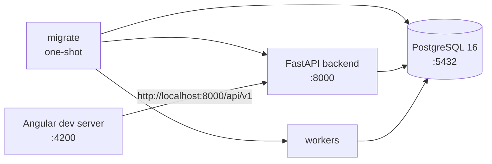

# DentalPilot AI — Local Setup & Development (Docker only)

**Audience:** developers joining DentalPilot AI.
**Scope:** local development (Docker only), staging, production deployment and the environment variable reference. Architecture is in [`TECHNICAL_ARCHITECTURE.md`](TECHNICAL_ARCHITECTURE.md).

> **Docker Compose is the only supported local workflow.** You do **not** need Node.js, npm, Python, pip, PostgreSQL or Redis on your host. The Compose stack builds the backend image from the real Dockerfile and runs the Angular dev server in a Node container.

---

## A. Prerequisites — Docker Desktop and Docker Compose

| Requirement | Version | Notes |
|---|---|---|
| Docker Desktop | 24+ | Includes Docker Engine and Compose v2 |
| Docker Compose | v2 (`docker compose`) | Not the legacy `docker-compose` |
| Git | any recent | Clone the monorepo |
| Free ports | `4200`, `8000`, `5432` | Angular, FastAPI, PostgreSQL |

Verify:

```bash
docker --version
docker compose version
```

No other host tooling is required.

---

## B. Local Docker architecture

`docker-compose.local.yml` runs five services:

| Service | Image / build | Port | Purpose |
|---|---|---|---|
| `postgres` | `postgres:16-alpine` | `5432` | Persistent PostgreSQL 16 |
| `migrate` | build `./backend` | — | One-shot `alembic upgrade head` |
| `backend` | build `./backend` | `8000` | FastAPI with `uvicorn --reload` |
| `workers` | build `./backend` | — | `python -m app.workers.run_workers` |
| `frontend` | `node:22-alpine` | `4200` | Angular dev server with HMR |



- **Redis is excluded.** The application does not use Redis (no client in `requirements.txt`, no `redis` import in `app/`). The outbox workers are PostgreSQL-backed.
- The frontend source is bind-mounted; a named volume caches `node_modules`.
- The backend source is bind-mounted for reload.
- Only `frontend` (`4200`), `backend` (`8000`) and `postgres` (`5432`) publish host ports. `workers` and `migrate` have **no published ports**.

---

## C. Environment configuration

```bash
cd products/healthcare/dental/dentalpilot-ai
cp .env.local.example .env.local
```

Edit `.env.local` and set at least:

```dotenv
POSTGRES_PASSWORD=<a local-only password>
JWT_SECRET=<output of: openssl rand -base64 48>
DATABASE_URL=postgresql+psycopg://dentalpilot:<the same POSTGRES_PASSWORD>@postgres:5432/dentalpilot
```

- `.env.local` is **gitignored**; never commit it.
- Optional integrations (`XAI_*`, `RAZORPAY_*`, `S3_*`, `SMTP_*`, `WHATSAPP_*`) may be left empty; the app starts and those features return `503`.
- The full variable reference is in §O.

---

## D. One-command local startup

```bash
docker compose -f docker-compose.local.yml up -d --build
```

This single command:

1. Starts PostgreSQL 16 and waits for `pg_isready`.
2. Runs the one-shot `migrate` service (`alembic upgrade head`).
3. Starts the FastAPI backend (`uvicorn --reload --reload-dir app`) after migrations complete.
4. Starts the background workers after migrations complete.
5. Starts the Angular dev server (HMR) after the backend is healthy.

Check status:

```bash
docker compose -f docker-compose.local.yml ps
```

On the first frontend start, the container runs `npm ci` inside the container (no host Node.js needed). Subsequent starts reuse the `frontend_node_modules` volume.

---

## E. Complete local service access reference

| Service | URL / host | Port | Purpose | Health / verification |
|---|---|---|---|---|
| Angular frontend | <http://localhost:4200> | `4200` | Browser-accessible SPA (Angular dev server, HMR) | `docker compose ... ps` → frontend `(healthy)`; `curl http://localhost:4200/` → 200 |
| FastAPI backend | <http://localhost:8000> | `8000` | HTTP API (`/api/v1`) | `curl http://localhost:8000/health` |
| Swagger UI | <http://localhost:8000/docs> | `8000` | Interactive API docs | `curl -I http://localhost:8000/docs` |
| OpenAPI JSON | <http://localhost:8000/openapi.json> | `8000` | Machine-readable schema | `curl http://localhost:8000/openapi.json` |
| Liveness | <http://localhost:8000/health/live> | `8000` | Process liveness | `curl http://localhost:8000/health/live` |
| Readiness | <http://localhost:8000/health/ready> | `8000` | DB readiness (`SELECT 1`) | `curl http://localhost:8000/health/ready` |
| PostgreSQL | `dentalpilot-local-postgres:5432` (host `localhost:5432`) | `5432` | Database | `docker compose ... exec postgres pg_isready -U dentalpilot -d dentalpilot` |
| Background workers | `dentalpilot-local-workers` (no published port) | — | Email / communication / billing loops | `docker compose ... logs workers`; no HTTP health endpoint |
| Migration service | `dentalpilot-local-migrate` (one-shot) | — | `alembic upgrade head` | `docker compose ... ps -a` (Exited 0); `logs migrate` |
| Redis | **excluded** | — | Not used by app code | — |

**Internal vs browser-accessible:** only the Angular frontend (`4200`), FastAPI (`8000`) and PostgreSQL (`5432`) publish host ports. `workers` and `migrate` have **no published ports** and are reachable only inside the `dentalpilot-local` Docker network.

**Services without HTTP health endpoints:**

- **Workers:** no HTTP server. Verify with `docker compose ... logs workers` and `docker compose ... ps`. A running container does **not** prove all three loops are healthy — check for the three `Starting ... worker` lines and the absence of repeated tracebacks.
- **Migration service:** one-shot. Verify with `docker compose ... ps -a` (Exited 0) and `logs migrate`.

**Demo accounts (local only):** run the seed script and use the credentials it prints:

```bash
docker compose -f docker-compose.local.yml exec -T backend python scripts/seed_hierarchy.py
```

Never use these credentials in staging or production.

---

## F. Hot reload — Angular and FastAPI

### F.1 Angular (frontend container)

The frontend container runs `ng serve` with `--host 0.0.0.0 --port 4200 --poll 1000`. `--poll 1000` and `CHOKIDAR_USEPOLLING=true` make file watching reliable on macOS Docker Desktop.

| Change | Result |
|---|---|
| `.ts` component/service | Rebuild; browser updates |
| `.html` template | Rebuild; view updates |
| `.css` / `.scss` | Styles rebuilt and re-applied |
| `angular.json` / `package.json` | Dev server may restart |

Verified startup output includes:

```text
Watch mode enabled. Watching for file changes...
  ➜  Local:   http://localhost:4200/
```

No manual restart is required for ordinary edits.

### F.2 FastAPI (backend container)

The backend container runs `uvicorn app.main:app --reload --reload-dir app`. Python changes under `app/` trigger a reload.

| Change | Restarts? |
|---|---|
| Python file under `app/` | **Yes** |
| `.env` / environment variables | **No** — restart the backend container |
| `requirements.txt` / new dependency | **No** — rebuild the image |
| Alembic migration | **No** — run the `migrate` service, then restart |

Verified log line:

```text
WARNING:  WatchFiles detected changes in 'app/main.py'. Reloading...
```

**Production never uses reload.** See §L (Railway) and §M (Compose VPS).

---

## G. Database and migrations

- PostgreSQL 16 runs in the `postgres` service with the `postgres_local_data` named volume.
- The `migrate` service runs `alembic upgrade head` **once** per `up`; backend and workers wait for it to complete successfully (`service_completed_successfully`).
- Do **not** run `alembic upgrade head` again manually in this mode.

Inspect migrations:

```bash
docker compose -f docker-compose.local.yml run --rm migrate alembic current
docker compose -f docker-compose.local.yml run --rm migrate alembic history
```

Backup and restore (local):

```bash
# Backup
docker compose -f docker-compose.local.yml exec -T postgres pg_dump -U dentalpilot dentalpilot > backup.sql

# Restore (destructive — local only)
docker compose -f docker-compose.local.yml exec -T postgres psql -U dentalpilot dentalpilot < backup.sql
```

> The Docker path uses PostgreSQL and avoids the SQLite migration bug (`e78cbd0fad9c`). Native SQLite is **not** a supported local workflow.

---

## H. Background workers

The `workers` service runs `python -m app.workers.run_workers`, which starts three database-backed loops:

1. `email_outbox` — sends queued patient emails via SMTP.
2. `communication_outbox` — sends queued patient email/SMS/WhatsApp messages.
3. `subscription_billing` — processes Razorpay webhook events, renewals, failures and cancellations.

- Logs: `docker compose -f docker-compose.local.yml logs -f workers`.
- The worker has no HTTP healthcheck (the backend image's HTTP healthcheck is disabled for this service).
- Do not run a second worker against the same database.
- Redis is not used.

---

## I. Docker operational commands

```bash
# Status
docker compose -f docker-compose.local.yml ps

# Logs
docker compose -f docker-compose.local.yml logs -f backend frontend workers

# Stop (keeps volumes)
docker compose -f docker-compose.local.yml stop

# Stop and remove containers (keeps volumes)
docker compose -f docker-compose.local.yml down

# Restart
docker compose -f docker-compose.local.yml restart backend workers

# Rebuild
docker compose -f docker-compose.local.yml up -d --build

# Database access
docker compose -f docker-compose.local.yml exec postgres psql -U dentalpilot dentalpilot

# Reset local data (DESTRUCTIVE — local volumes only)
docker compose -f docker-compose.local.yml down -v
docker compose -f docker-compose.local.yml up -d --build
```

> `down -v` deletes the local Postgres volume. Never run it against staging or production.

---

## J. Troubleshooting

| Problem | Fix |
|---|---|
| Frontend not reachable | `docker compose ... ps`; `logs frontend`; port `4200` free |
| Frontend changes not detected | `--poll 1000` is already set; restart the frontend container |
| Backend `503` on startup | `logs backend`; check `DATABASE_URL` and that `migrate` completed |
| `migrate` service failed | `logs migrate`; fix the migration; `up -d --build` |
| `psycopg2` / driver error | `DATABASE_URL` must use `postgresql+psycopg://` |
| Worker not sending | `logs workers`; check SMTP/WhatsApp vars |
| Worker thread died | Check DB connectivity; `docker compose restart workers` |
| Port already in use | `lsof -i :8000`, `:4200`, `:5432` |
| Frontend cannot reach API | Backend on `:8000`; `CORS_ORIGINS` includes `http://localhost:4200` |
| `npm ci` fails in frontend container | Ensure `package-lock.json` exists; `docker compose ... down -v` only if you intend to reset the node_modules volume |
| Docker build fails | Run from the DentalPilot AI directory; check the Dockerfile path |

---

## K. Staging deployment

Staging reuses the production Compose stack with staging overrides:

```bash
cp .env.staging.example .env.staging
# Edit .env.staging: staging POSTGRES_PASSWORD, JWT_SECRET, CORS_ORIGINS, optional integrations
docker compose -f docker-compose.yml -f docker-compose.staging.yml up -d
```

- HTTP-only Nginx on `http://<staging-host>:8080` (`nginx/staging/default.conf`).
- `APP_ENVIRONMENT=staging` and staging CORS origins.
- Separate PostgreSQL volume; **never reuse production credentials**.

---

## L. Production deployment — Railway

### L.1 Create the project

1. Railway → **New Project → Deploy from GitHub repo** (`saman2ny/otheryn-platform`).
2. Add the services below, setting **Settings → Source → Root Directory** for each.

### L.2 PostgreSQL

1. **New → Database → PostgreSQL**.
2. In the backend and worker **Variables**, set:

```dotenv
DATABASE_URL=postgresql+psycopg://${{Postgres.PGUSER}}:${{Postgres.PGPASSWORD}}@${{Postgres.PGHOST}}:${{Postgres.PGPORT}}/${{Postgres.PGDATABASE}}
```

> **Critical:** Railway's `${{Postgres.DATABASE_URL}}` is `postgresql://...`; SQLAlchemy would select `psycopg2`, which is **not installed**. Always use `postgresql+psycopg://`.
3. Use Railway private networking; do not expose Postgres publicly.
4. **Redis is not used** — do not add a Redis service.

### L.3 Backend

1. Root directory: `products/healthcare/dental/dentalpilot-ai/backend` (monorepo) or `backend` (standalone).
2. Builder: **Nixpacks** (`railway.toml`).
3. Start command (from `railway.toml`, do **not** override in the dashboard):

```bash
alembic upgrade head && uvicorn app.main:app --host 0.0.0.0 --port $PORT
```

4. Health check path: `/health`.
5. Generate a domain (`api.dentalpilot.in`), attach TLS.
6. Required variables: `DATABASE_URL`, `JWT_SECRET`, `APP_ENVIRONMENT=production`, `CORS_ORIGINS`.
7. Optional: `XAI_*`, `RAZORPAY_*`, `S3_*`, `AWS_REGION`, `SMTP_*`, `WHATSAPP_*`.

> **No `--reload` in production.**

### L.4 Worker

1. Add a **separate Railway service** from the same repo/root.
2. Custom start command:

```bash
python -m app.workers.run_workers
```

3. Same `DATABASE_URL`, `JWT_SECRET`, `APP_ENVIRONMENT` and integration variables as the backend.
4. No public domain, no health path.
5. The worker **must not run migrations** — the backend start command runs `alembic upgrade head`; the worker only polls.
6. Logs: Railway → Deployments → Deploy Logs.

### L.5 Frontend

1. Root directory: `products/healthcare/dental/dentalpilot-ai/frontend` (or `frontend`).
2. Railway detects `frontend/Dockerfile` (`node:20-alpine` → `npm ci && npm run build` → `nginx:alpine`).
3. **Build-time API URL:** `src/environments/environment.prod.ts` → `https://api.dentalpilot.in/api/v1`. Changing Railway variables does **not** change the bundle; edit the file and rebuild.
4. Generate a domain (`dentalpilot.in`, `www.dentalpilot.in`), attach TLS.
5. Nginx serves the SPA, proxies `/api/` to `https://api.dentalpilot.in`, returns `/health` = `healthy`, caches hashed assets.

### L.6 Migrations on Railway

- The backend start command runs `alembic upgrade head` on every deploy.
- Do **not** add a separate migration service.
- Migrations are forward-only.
- Inspect: `railway run alembic current`, `railway run alembic history`.

### L.7 Verify and roll back

```bash
curl https://api.dentalpilot.in/health
curl https://api.dentalpilot.in/health/ready
curl -I https://dentalpilot.in/health
```

- **Logs:** Railway → service → Deployments → Build/Deploy/HTTP Logs, or `railway logs`.
- **Rollback:** Railway → service → Deployments → previous deployment → Redeploy.
- Schema changes are forward-only; a destructive migration requires a restore or follow-up migration.

---

## M. Production deployment — Docker Compose VPS

### M.1 Prerequisites

- Docker 24+ with Compose v2.
- Ports `80`/`443` free.
- SSL certificates in `nginx/ssl/`: `fullchain.pem`, `privkey.pem`, `chain.pem`.
- GHCR images built by CI (or built locally).

### M.2 Environment

```bash
cp .env.production.example .env.production
# Edit .env.production: POSTGRES_PASSWORD, JWT_SECRET, CORS_ORIGINS, optional integrations
```

### M.3 Deploy

```bash
./deploy.sh production
```

`deploy.sh`:

1. Sources `.env.production`.
2. Validates `POSTGRES_PASSWORD` and `JWT_SECRET`.
3. Pulls images (`${REGISTRY}/${IMAGE_NAME}-backend|frontend:${IMAGE_TAG}`).
4. Runs `docker compose ... up -d --remove-orphans`.
5. The one-shot `migrate` service runs `alembic upgrade head` before backend/workers.
6. Health-checks the frontend and backend.

For staging: `./deploy.sh staging` (HTTP-only, port `8080`, `nginx/staging/default.conf`).

### M.4 Nginx

`nginx/conf.d/default.conf` (mounted by `docker-compose.yml`):

- Listens on `80` (redirects to HTTPS) and `443` (TLS).
- Proxies `/api/` to `http://backend` (preserving the `/api/` prefix).
- Adds HSTS, X-Frame-Options, nosniff, Referrer-Policy, Permissions-Policy.
- Caches hashed static assets for 1 year.
- `/health` returns `200 healthy`.

### M.5 Migrations

- The one-shot `migrate` service runs `alembic upgrade head` before backend/workers.
- Do not run migrations manually during a normal deploy.
- Forward-only.

### M.6 Backups and restore

```bash
# Backup
docker compose -f docker-compose.yml exec -T postgres pg_dump -U dentalpilot dentalpilot > dentalpilot-$(date +%F).sql

# Restore (destructive — verify first)
docker compose -f docker-compose.yml exec -T postgres psql -U dentalpilot dentalpilot < dentalpilot-YYYY-MM-DD.sql
```

- Enable provider-level backups/PITR where available.
- Test restore regularly.

### M.7 Health checks and rollback

```bash
curl -f http://localhost/health
docker compose -f docker-compose.yml exec -T backend curl -sf http://localhost:8000/health
```

- Rollback: set `IMAGE_TAG` to the previous immutable tag in `.env.production`, then `./deploy.sh production`.
- Schema rollback requires a DB restore or a follow-up migration.

---

## N. Production service inventory

| Service | Public access | Port | Purpose | Health / verification |
|---|---|---|---|---|
| Frontend (Nginx + Angular) | `https://dentalpilot.in`, `https://www.dentalpilot.in` | `443` (TLS), `80` → 443 | Static SPA + `/api/` reverse proxy | `curl -I https://dentalpilot.in/health` → `200 healthy` |
| Backend API (FastAPI) | `https://api.dentalpilot.in` | `443` (TLS) | REST API `/api/v1` | `curl https://api.dentalpilot.in/health`; `/health/live`; `/health/ready` |
| Swagger UI | `https://api.dentalpilot.in/docs` | `443` | Interactive API docs | `curl -I https://api.dentalpilot.in/docs` |
| OpenAPI JSON | `https://api.dentalpilot.in/openapi.json` | `443` | Schema | `curl https://api.dentalpilot.in/openapi.json` |
| Worker | **none** (internal) | — | Email / communication / billing loops | `railway logs` / `docker compose logs workers`; no HTTP health |
| PostgreSQL | **none** (private) | `5432` internal | Database | `pg_isready`; Railway health |
| Migration | **none** (one-shot) | — | `alembic upgrade head` | Exit code 0; `logs migrate` |
| Redis | **excluded** | — | Not used by app code | — |

**Public vs internal:** only the frontend and backend API are public. PostgreSQL is private (Railway private networking / Docker network). The worker and migration services have no public endpoint.

**Staging:** frontend `http://<staging-host>:8080`; backend `https://api.staging.dentalpilot.in`; PostgreSQL private.

---

## O. Environment variable reference

### O.1 Build-time vs runtime

| Component | Configuration source | When applied | How to change |
|---|---|---|---|
| **Angular frontend** | `frontend/src/environments/environment.prod.ts` | **Build time** (`angular.json` `fileReplacements`) | Edit the file and **rebuild** |
| **FastAPI backend** | `app/core/config.py` via environment variables | **Runtime** | Change the variable and **restart/redeploy** |
| **Workers** | Same as backend | **Runtime** | Change the variable and **restart** |
| **Nginx** | `frontend/nginx.conf` / `nginx/conf.d` | **Runtime** | Rebuild the image or mount a config |

Railway variables do **not** affect the Angular bundle. The frontend API URL is set in `src/environments/environment.prod.ts`:

```ts
export const environment = {
  production: true,
  apiBaseUrl: 'https://api.dentalpilot.in/api/v1',
};
```

### O.2 Core variables

| Variable | Service | Required | Purpose | Local / Production | Setting |
|---|---|---|---|---|---|
| `APP_ENVIRONMENT` | backend, worker | ✅ | `development` / `test` / `staging` / `production` | both | runtime |
| `DATABASE_URL` | backend, worker | ✅ | SQLAlchemy URL (`postgresql+psycopg://`) | both | runtime |
| `JWT_SECRET` | backend, worker | ✅ | JWT signing (32+ chars in production) | both | runtime |
| `JWT_ALGORITHM` | backend, worker | optional | JWT algorithm | both | runtime |
| `ACCESS_TOKEN_EXPIRE_MINUTES` | backend | optional | Access token lifetime | both | runtime |
| `REFRESH_TOKEN_EXPIRE_DAYS` | backend | optional | Refresh token lifetime | both | runtime |
| `CORS_ORIGINS` | backend | ✅ in prod | Allowed origins (JSON array) | both | runtime |
| `MAX_PATIENT_DOCUMENT_BYTES` | backend, worker | optional | Upload size limit | both | runtime |

> **`DATABASE_URL` must use `postgresql+psycopg://`.** Railway's `${{Postgres.DATABASE_URL}}` is `postgresql://...`; SQLAlchemy would try `psycopg2`, which is **not installed**.

### O.3 Integration variables (all optional)

Disabled integrations fail gracefully (`503`) — the app still starts.

| Variable | Service | Purpose | Local | Production |
|---|---|---|---|---|
| `XAI_API_KEY` | backend, worker | xAI Grok API key | optional | optional |
| `XAI_MODEL` | backend, worker | Grok model (`grok-4.7`) | optional | optional |
| `XAI_BASE_URL` | backend, worker | xAI API base (`https://api.x.ai/v1`) | optional | optional |
| `CLINICAL_NOTE_DRAFTING_ENABLED` | backend | Enable AI note drafting | optional | optional |
| `CLINICAL_AI_DATA_PROCESSING_APPROVED` | backend | Consent gate for AI notes | optional | optional |
| `RAZORPAY_KEY_ID` | backend, worker | Razorpay key | optional | optional |
| `RAZORPAY_KEY_SECRET` | backend, worker | Razorpay secret | optional | optional |
| `RAZORPAY_WEBHOOK_SECRET` | backend, worker | Webhook verification | optional | required with Razorpay |
| `RAZORPAY_CURRENCY` | backend, worker | Subscription currency | optional | optional |
| `RAZORPAY_PLAN_IDS` | backend, worker | Tier/cycle → plan IDs (JSON) | optional | required with Razorpay |
| `PATIENT_PAYMENT_CURRENCY` | backend, worker | Treatment payment currency | optional | optional |
| `S3_BUCKET` | backend, worker | Document bucket | optional | optional |
| `S3_ENDPOINT_URL` | backend, worker | S3-compatible endpoint | optional | optional |
| `AWS_REGION` | backend, worker | AWS region | optional | optional |
| `S3_KMS_KEY_ID` | backend, worker | KMS key for SSE | optional | optional |
| `SMTP_HOST` | backend, worker | SMTP server | optional | optional |
| `SMTP_PORT` | backend, worker | SMTP port | optional | optional |
| `SMTP_USERNAME` | backend, worker | SMTP user | optional | optional |
| `SMTP_PASSWORD` | backend, worker | SMTP password | optional | optional |
| `SMTP_SENDER_EMAIL` | backend, worker | Sender address | optional | optional |
| `SMTP_SENDER_NAME` | backend, worker | Sender name | optional | optional |
| `SMTP_USE_SSL` | backend, worker | Implicit SSL | optional | optional |
| `SMTP_USE_STARTTLS` | backend, worker | STARTTLS | optional | optional |
| `EMAIL_WORKER_INTERVAL_SECONDS` | worker | Email poll interval | optional | optional |
| `EMAIL_MAX_ATTEMPTS` | worker | Email retry cap | optional | optional |
| `WHATSAPP_PHONE_NUMBER_ID` | backend, worker | WhatsApp sender ID | optional | optional |
| `WHATSAPP_ACCESS_TOKEN` | backend, worker | WhatsApp token | optional | optional |
| `WHATSAPP_WEBHOOK_VERIFY_TOKEN` | backend, worker | WhatsApp webhook verification | optional | optional |
| `SUBSCRIPTION_GRACE_PERIOD_DAYS` | worker | Grace period | optional | optional |
| `BILLING_WEBHOOK_INTERVAL_SECONDS` | worker | Billing poll interval | optional | optional |
| `BILLING_WEBHOOK_MAX_ATTEMPTS` | worker | Billing retry cap | optional | optional |
| `SUBSCRIPTION_RECONCILIATION_INTERVAL_SECONDS` | worker | Reconciliation interval | optional | optional |

**Redis is not used by application code.** Do not add Redis variables unless you implement a Redis-backed feature.

### O.4 Compose-only variables

| Variable | Used by | Purpose |
|---|---|---|
| `POSTGRES_USER` | Postgres container, backend `DATABASE_URL` | DB user |
| `POSTGRES_PASSWORD` | Postgres container, backend `DATABASE_URL` | DB password |
| `POSTGRES_DB` | Postgres container, backend `DATABASE_URL` | DB name |
| `POSTGRES_PORT` | local Compose | Host port for Postgres |
| `BACKEND_PORT` | local Compose | Host port for FastAPI |
| `FRONTEND_PORT` | local Compose | Host port for Angular |
| `REGISTRY` | production Compose | Image registry (e.g. `ghcr.io`) |
| `IMAGE_NAME` | production Compose | Image name |
| `IMAGE_TAG` | production Compose | Immutable tag (e.g. `sha-<commit>`) |

### O.5 Local vs production

| Variable | Local (`docker-compose.local.yml`) | Production (Railway / Compose) |
|---|---|---|
| `APP_ENVIRONMENT` | `development` | `production` |
| `DATABASE_URL` | `postgresql+psycopg://...@postgres:5432/...` | `postgresql+psycopg://...` (Railway Postgres) |
| `JWT_SECRET` | local-only random | 32+ random |
| `CORS_ORIGINS` | `["http://localhost:4200"]` | `["https://dentalpilot.in"]` |
| `XAI_*` / `RAZORPAY_*` / `S3_*` / `SMTP_*` | optional/empty | production values |
| `POSTGRES_*` | local Compose | not used (Railway Postgres) |
| `REGISTRY` / `IMAGE_NAME` / `IMAGE_TAG` | not used | production Compose |

**Never point a local `.env` at a production database.**

### O.6 Secret handling

- Never commit `.env*` files (the root `.gitignore` ignores them).
- Railway: set variables in the service settings or `railway variables --set`.
- Compose VPS: `.env.production` on the host, `chmod 600`.
- Production `JWT_SECRET` ≥32 chars; `DATABASE_URL` non-SQLite; no `*` CORS.
- Do not log secrets or patient data.

### O.7 Verify which database you are connected to

```bash
# Native backend (venv active) — only for non-Docker development
python -c "from app.core.config import settings; from urllib.parse import urlparse; u=urlparse(settings.database_url); print('host=', u.hostname, 'db=', u.path)"

# Docker Compose backend
docker compose -f docker-compose.local.yml exec backend python -c "from app.core.config import settings; from urllib.parse import urlparse; u=urlparse(settings.database_url); print('host=', u.hostname, 'db=', u.path)"

# Railway backend
railway run python -c "from app.core.config import settings; from urllib.parse import urlparse; u=urlparse(settings.database_url); print('host=', u.hostname, 'db=', u.path)"
```

Expected: local Docker `host= postgres db= /dentalpilot`; production `host= <railway-postgres-host> db= /railway`.

---

## P. Security

- HTTPS/TLS at the edge; HSTS.
- Explicit CORS origins.
- JWT (HS256), bcrypt passwords.
- Webhook signature verification (Razorpay).
- S3 private bucket + SSE/KMS.
- Audit events for sensitive actions.
- **Known gaps:** no app-level rate limiting, tokens in `localStorage`, logout no-op, partial audit coverage, no CSP. See [`AUDIT/PRODUCT_IMPLEMENTATION_AUDIT.md`](../../AUDIT/PRODUCT_IMPLEMENTATION_AUDIT.md).

---

## Q. Backups, restore and rollback

- **PostgreSQL:** enable Railway backups/PITR; logical `pg_dump` (see §M.6).
- **Documents:** S3 versioning + lifecycle + tested restore.
- **Code:** Git history + tags.
- **Rollback:** Railway → Deployments → previous → Redeploy; Compose → set `IMAGE_TAG` to the previous tag and `./deploy.sh production`.
- Schema changes are forward-only; a destructive migration requires a DB restore or a follow-up migration.

---

## R. Verification status

| Claim | Status |
|---|---|
| Compose config (local/staging/production) | Configuration validated (`docker compose config`) |
| Nginx config | Configuration validated (`nginx -t`) |
| Backend image build | Verified |
| Railway deployment | Documented — **not executed** |
| Production migrations | Documented — **not executed** |
| Backup/restore | Documented — **not executed** |
| Rollback | Documented — **not executed** |

---

## S. Related documentation

- [`TECHNICAL_ARCHITECTURE.md`](TECHNICAL_ARCHITECTURE.md) — architecture.
- [`BUSINESS_PROPOSAL.md`](BUSINESS_PROPOSAL.md) — business strategy.
- [`RELEASE_NOTES.md`](../../RELEASE_NOTES.md) — version history.
- [`../../frontend/README.md`](../../frontend/README.md) — frontend component guide.
- [`../../backend/README.md`](../../backend/README.md) — backend component guide.
- [`../../CONTRIBUTING.md`](../../CONTRIBUTING.md) — contribution workflow.