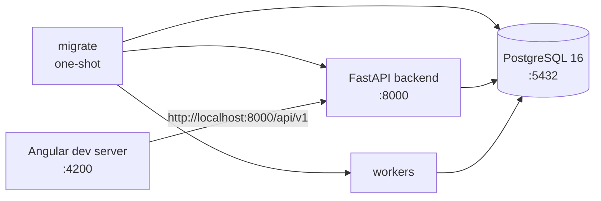

# DentalPilot AI — Local Setup & Development (Docker only)

**Audience:** developers joining DentalPilot AI.
**Scope:** local development **only**. Production deployment is in [`DEPLOYMENT.md`](../../DEPLOYMENT.md). Environment variables are in [`ENVIRONMENT.md`](../../ENVIRONMENT.md). Architecture is in [`TECHNICAL_ARCHITECTURE.md`](TECHNICAL_ARCHITECTURE.md).

> **Docker Compose is the only supported local workflow.** You do **not** need Node.js, npm, Python, pip, PostgreSQL or Redis on your host. The Compose stack builds the backend image from the real Dockerfile and runs the Angular dev server in a Node container.

---

## A. Prerequisites — Docker Desktop and Docker Compose

| Requirement | Version | Notes |
|---|---|---|
| Docker Desktop | 24+ | Includes Docker Engine and Compose v2 |
| Docker Compose | v2 (`docker compose`) | Not the legacy `docker-compose` |
| Git | any recent | Clone the monorepo |
| Free ports | `4200`, `8000`, `5432` | Angular, FastAPI, PostgreSQL |

Verify:

```bash
docker --version
docker compose version
```

No other host tooling is required.

---

## B. Local Docker architecture

`docker-compose.local.yml` runs five services:

| Service | Image / build | Port | Purpose |
|---|---|---|---|
| `postgres` | `postgres:16-alpine` | `5432` | Persistent PostgreSQL 16 |
| `migrate` | build `./backend` | — | One-shot `alembic upgrade head` |
| `backend` | build `./backend` | `8000` | FastAPI with `uvicorn --reload` |
| `workers` | build `./backend` | — | `python -m app.workers.run_workers` |
| `frontend` | `node:22-alpine` | `4200` | Angular dev server with HMR |



- **Redis is excluded.** The application does not use Redis (no client in `requirements.txt`, no `redis` import in `app/`). The outbox workers are PostgreSQL-backed.
- The frontend source is bind-mounted; a named volume caches `node_modules`.
- The backend source is bind-mounted for reload.
- Only `frontend` (`4200`), `backend` (`8000`) and `postgres` (`5432`) publish host ports. `workers` and `migrate` have **no published ports**.

---

## C. Environment configuration

```bash
cd products/healthcare/dental/dentalpilot-ai
cp .env.local.example .env.local
```

Edit `.env.local` and set at least:

```dotenv
POSTGRES_PASSWORD=<a local-only password>
JWT_SECRET=<output of: openssl rand -base64 48>
DATABASE_URL=postgresql+psycopg://dentalpilot:<the same POSTGRES_PASSWORD>@postgres:5432/dentalpilot
```

- `.env.local` is **gitignored**; never commit it.
- Optional integrations (`XAI_*`, `RAZORPAY_*`, `S3_*`, `SMTP_*`, `WHATSAPP_*`) may be left empty; the app starts and those features return `503`.
- The full variable reference is in [`ENVIRONMENT.md`](../../ENVIRONMENT.md).

---

## D. One-command local startup

```bash
docker compose -f docker-compose.local.yml up -d --build
```

This single command:

1. Starts PostgreSQL 16 and waits for `pg_isready`.
2. Runs the one-shot `migrate` service (`alembic upgrade head`).
3. Starts the FastAPI backend (`uvicorn --reload --reload-dir app`) after migrations complete.
4. Starts the background workers after migrations complete.
5. Starts the Angular dev server (HMR) after the backend is healthy.

Check status:

```bash
docker compose -f docker-compose.local.yml ps
```

On the first frontend start, the container runs `npm ci` inside the container (no host Node.js needed). Subsequent starts reuse the `frontend_node_modules` volume.

---

## E. Complete local service access reference

| Service | URL / host | Port | Purpose | Health / verification |
|---|---|---|---|---|
| Angular frontend | <http://localhost:4200> | `4200` | Browser-accessible SPA (Angular dev server, HMR) | `docker compose ... ps` → frontend `(healthy)`; `curl http://localhost:4200/` → 200 |
| FastAPI backend | <http://localhost:8000> | `8000` | HTTP API (`/api/v1`) | `curl http://localhost:8000/health` |
| Swagger UI | <http://localhost:8000/docs> | `8000` | Interactive API docs | `curl -I http://localhost:8000/docs` |
| OpenAPI JSON | <http://localhost:8000/openapi.json> | `8000` | Machine-readable schema | `curl http://localhost:8000/openapi.json` |
| Liveness | <http://localhost:8000/health/live> | `8000` | Process liveness | `curl http://localhost:8000/health/live` |
| Readiness | <http://localhost:8000/health/ready> | `8000` | DB readiness (`SELECT 1`) | `curl http://localhost:8000/health/ready` |
| PostgreSQL | `dentalpilot-local-postgres:5432` (host `localhost:5432`) | `5432` | Database | `docker compose ... exec postgres pg_isready -U dentalpilot -d dentalpilot` |
| Background workers | `dentalpilot-local-workers` (no published port) | — | Email / communication / billing loops | `docker compose ... logs workers`; no HTTP health endpoint |
| Migration service | `dentalpilot-local-migrate` (one-shot) | — | `alembic upgrade head` | `docker compose ... ps -a` (Exited 0); `logs migrate` |
| Redis | **excluded** | — | Not used by app code | — |

**Internal vs browser-accessible:** only the Angular frontend (`4200`), FastAPI (`8000`) and PostgreSQL (`5432`) publish host ports. `workers` and `migrate` have **no published ports** and are reachable only inside the `dentalpilot-local` Docker network.

**Services without HTTP health endpoints:**

- **Workers:** no HTTP server. Verify with `docker compose ... logs workers` and `docker compose ... ps`. A running container does **not** prove all three loops are healthy — check for the three `Starting ... worker` lines and the absence of repeated tracebacks.
- **Migration service:** one-shot. Verify with `docker compose ... ps -a` (Exited 0) and `logs migrate`.

**Demo accounts (local only):** run the seed script and use the credentials it prints:

```bash
docker compose -f docker-compose.local.yml exec -T backend python scripts/seed_hierarchy.py
```

Never use these credentials in staging or production.

---

## F. Hot reload — Angular and FastAPI

### F.1 Angular (frontend container)

The frontend container runs `ng serve` with `--host 0.0.0.0 --port 4200 --poll 1000`. `--poll 1000` and `CHOKIDAR_USEPOLLING=true` make file watching reliable on macOS Docker Desktop.

| Change | Result |
|---|---|
| `.ts` component/service | Rebuild; browser updates |
| `.html` template | Rebuild; view updates |
| `.css` / `.scss` | Styles rebuilt and re-applied |
| `angular.json` / `package.json` | Dev server may restart |

Verified startup output includes:

```text
Watch mode enabled. Watching for file changes...
  ➜  Local:   http://localhost:4200/
```

No manual restart is required for ordinary edits.

### F.2 FastAPI (backend container)

The backend container runs `uvicorn app.main:app --reload --reload-dir app`. Python changes under `app/` trigger a reload.

| Change | Restarts? |
|---|---|
| Python file under `app/` | **Yes** |
| `.env` / environment variables | **No** — restart the backend container |
| `requirements.txt` / new dependency | **No** — rebuild the image |
| Alembic migration | **No** — run the `migrate` service, then restart |

Verified log line:

```text
WARNING:  WatchFiles detected changes in 'app/main.py'. Reloading...
```

**Production never uses reload.** See [`DEPLOYMENT.md`](../../DEPLOYMENT.md).

---

## G. Database and migrations

- PostgreSQL 16 runs in the `postgres` service with the `postgres_local_data` named volume.
- The `migrate` service runs `alembic upgrade head` **once** per `up`; backend and workers wait for it to complete successfully (`service_completed_successfully`).
- Do **not** run `alembic upgrade head` again manually in this mode.

Inspect migrations:

```bash
docker compose -f docker-compose.local.yml run --rm migrate alembic current
docker compose -f docker-compose.local.yml run --rm migrate alembic history
```

Backup and restore (local):

```bash
# Backup
docker compose -f docker-compose.local.yml exec -T postgres pg_dump -U dentalpilot dentalpilot > backup.sql

# Restore (destructive — local only)
docker compose -f docker-compose.local.yml exec -T postgres psql -U dentalpilot dentalpilot < backup.sql
```

> The Docker path uses PostgreSQL and avoids the SQLite migration bug (`e78cbd0fad9c`). Native SQLite is **not** a supported local workflow.

---

## H. Background workers

The `workers` service runs `python -m app.workers.run_workers`, which starts three database-backed loops:

1. `email_outbox` — sends queued patient emails via SMTP.
2. `communication_outbox` — sends queued patient email/SMS/WhatsApp messages.
3. `subscription_billing` — processes Razorpay webhook events, renewals, failures and cancellations.

- Logs: `docker compose -f docker-compose.local.yml logs -f workers`.
- The worker has no HTTP healthcheck (the backend image's HTTP healthcheck is disabled for this service).
- Do not run a second worker against the same database.
- Redis is not used.

---

## I. Docker operational commands

```bash
# Status
docker compose -f docker-compose.local.yml ps

# Logs
docker compose -f docker-compose.local.yml logs -f backend frontend workers

# Stop (keeps volumes)
docker compose -f docker-compose.local.yml stop

# Stop and remove containers (keeps volumes)
docker compose -f docker-compose.local.yml down

# Restart
docker compose -f docker-compose.local.yml restart backend workers

# Rebuild
docker compose -f docker-compose.local.yml up -d --build

# Database access
docker compose -f docker-compose.local.yml exec postgres psql -U dentalpilot dentalpilot

# Reset local data (DESTRUCTIVE — local volumes only)
docker compose -f docker-compose.local.yml down -v
docker compose -f docker-compose.local.yml up -d --build
```

> `down -v` deletes the local Postgres volume. Never run it against staging or production.

---

## J. Troubleshooting

| Problem | Fix |
|---|---|
| Frontend not reachable | `docker compose ... ps`; `logs frontend`; port `4200` free |
| Frontend changes not detected | `--poll 1000` is already set; restart the frontend container |
| Backend `503` on startup | `logs backend`; check `DATABASE_URL` and that `migrate` completed |
| `migrate` service failed | `logs migrate`; fix the migration; `up -d --build` |
| `psycopg2` / driver error | `DATABASE_URL` must use `postgresql+psycopg://` |
| Worker not sending | `logs workers`; check SMTP/WhatsApp vars |
| Worker thread died | Check DB connectivity; `docker compose restart workers` |
| Port already in use | `lsof -i :8000`, `:4200`, `:5432` |
| Frontend cannot reach API | Backend on `:8000`; `CORS_ORIGINS` includes `http://localhost:4200` |
| `npm ci` fails in frontend container | Ensure `package-lock.json` exists; `docker compose ... down -v` only if you intend to reset the node_modules volume |
| Docker build fails | Run from the DentalPilot AI directory; check the Dockerfile path |

---

## Related documentation

- [`DEPLOYMENT.md`](../../DEPLOYMENT.md) — production deployment (Railway + Compose VPS).
- [`ENVIRONMENT.md`](../../ENVIRONMENT.md) — complete environment variable reference.
- [`TECHNICAL_ARCHITECTURE.md`](TECHNICAL_ARCHITECTURE.md) — architecture.
- [`BUSINESS_PROPOSAL.md`](BUSINESS_PROPOSAL.md) — business strategy.
- [`RELEASE_NOTES.md`](../../RELEASE_NOTES.md) — version history.
- [`../../frontend/README.md`](../../frontend/README.md) — frontend component guide.
- [`../../backend/README.md`](../../backend/README.md) — backend component guide.
- [`../../CONTRIBUTING.md`](../../CONTRIBUTING.md) — contribution workflow.