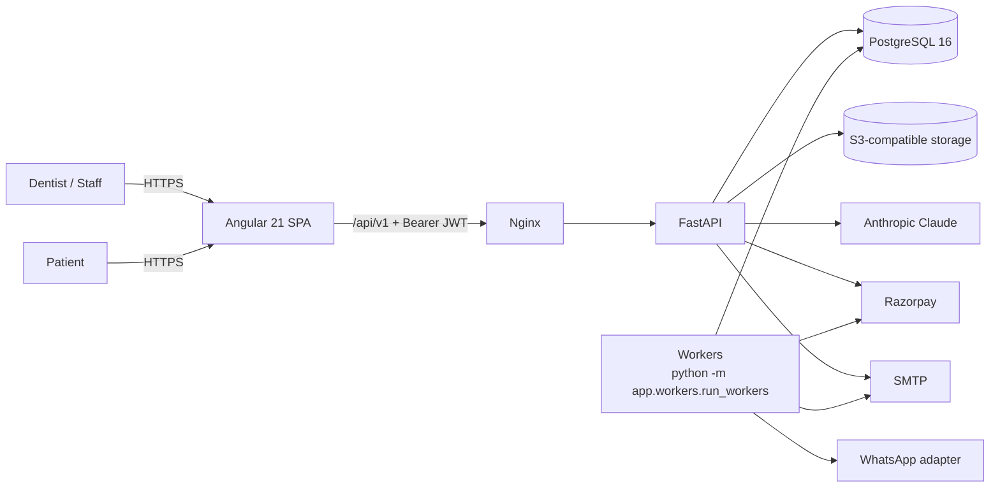
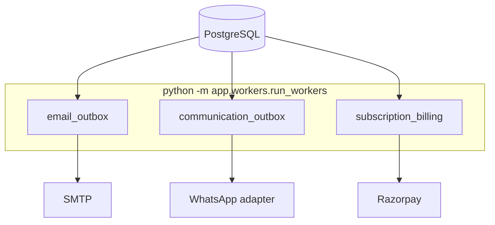

# DentalPilot AI — Technical Architecture

**Audience:** staff/principal engineers, software architects, backend/frontend developers, DevOps/platform engineers.
**Scope:** engineering architecture and technical design. For operations see [`SETUP_AND_DEPLOYMENT.md`](SETUP_AND_DEPLOYMENT.md); for business context see [`BUSINESS_PROPOSAL.md`](BUSINESS_PROPOSAL.md); for version history see [`RELEASE_NOTES.md`](../../RELEASE_NOTES.md).

> **Evidence convention:** "Implemented" means present in the current repository. "Planned" means proposed and **not** implemented. This document reflects the code at the time of writing; verify against source before relying on details.

---

## 1. System Overview

DentalPilot AI is a modular monorepo containing:

- **An Angular 21 single-page application** (`frontend/`).
- **A FastAPI REST API** (`backend/`) with 16 routers and ~156 endpoints under `/api/v1`.
- **A PostgreSQL/SQLite database** accessed through SQLAlchemy 2.0 with Alembic migrations.
- **Background workers** (`backend/app/workers/`) that poll database-backed outboxes.
- **External integrations**: Anthropic, Razorpay, SMTP, S3-compatible storage, WhatsApp Cloud API.
- **Infrastructure**: Dockerfiles, Docker Compose (local/production/staging), Nginx, Railway configuration, `deploy.sh`.

The system is a **multi-tenant SaaS**: each clinic's data is scoped by `clinic_id`; staff may be further scoped by `branch_id`. A separate patient portal provides patient-scoped access to records, shares and payments.

---

## 2. Architecture Principles

1. **Tenant isolation by default** — every tenant query filters by `clinic_id` (and `branch_id` for staff).
2. **Server-side authority** — validation, authorization and business rules live in the backend; the client is a hint.
3. **Database-backed reliability** — outboxes and webhooks are persisted; email can fail without losing a request.
4. **Human-in-the-loop clinical AI** — AI assists; clinicians review; note drafting is gated by consent.
5. **Independent product releases** — each product/app is versioned and deployed independently.
6. **Provider-neutral integrations** — CSV-first, adapter boundaries, no hard-coded vendor coupling.
7. **Privacy by design** — S3-private storage, presigned downloads, consent, audit.
8. **Progressive enhancement** — integrations fail gracefully (503) when unconfigured.

---

## 3. High-Level System Architecture



---

## 4. Technology Stack

| Layer | Technology | Version |
|---|---|---|
| Frontend | Angular | `^21.2.0` (standalone, zoneless, signals) |
| Frontend language | TypeScript | `~5.9.2` |
| Styling | Tailwind CSS | `^4.3.3` |
| Frontend tests | Vitest | `^4.0.8` |
| Backend | FastAPI | `0.139.2` |
| Backend language | Python | **3.12** (Docker); Railway Nixpacks `python311` |
| ORM | SQLAlchemy | `2.0.51` |
| Migrations | Alembic | `1.18.5` |
| Validation | Pydantic | `2.13.4` |
| Server | Uvicorn | `0.51.0` |
| Auth | bcrypt / PyJWT | `5.0.0` / `2.13.0` |
| AI | Anthropic SDK | `0.117.0` |
| Payments | Razorpay SDK | `2.0.1` |
| Storage | boto3 | `>=1.35,<2.0` |
| Database | PostgreSQL | **16**; SQLite default |
| Cache/queue | Redis | 7 in Compose — **not used by app code** |

---

## 5. Monorepo Architecture

```
products/healthcare/dental/dentalpilot-ai/
├── frontend/    # Angular 21 application
├── backend/     # FastAPI application + workers + Alembic
├── nginx/       # production/staging reverse-proxy configs
├── docker-compose*.yml
├── deploy.sh
├── .env*.example
├── docs/notion/ # authoritative docs (this file)
├── AUDIT/       # product implementation audit
└── RELEASE_NOTES.md
```

- **Frontend and backend are independently versioned and deployed.**
- Shared contracts: `frontend/src/app/core/constants/api-endpoints.const.ts` mirrors the FastAPI routers; Pydantic `CamelModel` converts snake_case ↔ camelCase.
- No shared code package; duplication between Zod-equivalent Pydantic schemas and TypeScript interfaces is intentional at the boundary.

---

## 6. Frontend Architecture

### 6.1 Overview

- Angular 21, **standalone components**, **zoneless** change detection, **signals** for state.
- Tailwind CSS v4 utility classes; no component stylesheets.
- Lazy-loaded feature routes; functional guards and interceptors.
- No NgRx; per-feature signal services.

### 6.2 Directory structure

```
src/app/
├── core/
│   ├── constants/   # API_ENDPOINTS (REST contract)
│   ├── guards/      # authGuard, guestGuard
│   ├── interceptors/# auth, error, loading
│   ├── models/      # TypeScript interfaces/DTOs
│   └── services/    # AuthService, TokenStorageService, NotificationService, LoadingService
├── shared/
│   ├── forms/       # formFieldClass()
│   ├── ui/          # PageHeader, EmptyState, StatCard, ToastContainer, LoadingBar
│   └── razorpay.d.ts
├── layout/
│   ├── shell/       # authenticated shell
│   └── auth-layout/ # centered auth layout
└── features/        # one folder per module, lazy-loaded
```

### 6.3 Feature modules

`auth`, `dashboard`, `clinic-profile`, `content-generator`, `content-calendar`, `clinic-growth-os`, `dental-operations`, `organization-management`, `export-content`, `billing`, `dentalpilot-workflows`, `patient-portal` (public), `staff-invitation` (public).

### 6.4 Routing and guards

- Public: `/auth/*` (`guestGuard`), `/patient-portal`, `/staff-invitation`.
- Authenticated: everything else behind `authGuard` and the shell.
- Fallback: unknown routes redirect to `/dashboard` (or `/auth/login`).

### 6.5 State and data flow

- Per-feature `signal()`/`computed()`.
- Services return `Observable`s from `HttpClient`.
- Global interceptors: `authInterceptor` (Bearer), `loadingInterceptor` (global bar), `errorInterceptor` (toasts; logout on 401 except patient portal).

### 6.6 Environment configuration

| File | Build | `apiBaseUrl` |
|---|---|---|
| `environment.ts` | `ng serve`, dev builds | `http://localhost:8000/api/v1` |
| `environment.prod.ts` | `ng build` (production) | `https://api.dentalpilot.in/api/v1` |

`angular.json` swaps the file via `fileReplacements`. **Build-time only** — Railway variables do not affect the bundle.

---

## 7. Backend Architecture

### 7.1 Entry point

`app/main.py` creates `FastAPI(title="DentalPilot AI API", version="1.2.0")`, registers middleware, includes 16 routers under `/api/v1`, and defines:

- `GET /health` → `{"status":"ok"}`
- `GET /health/live` → `{"status":"alive"}`
- `GET /health/ready` → `{"status":"ready","database":"ok"}` (executes `SELECT 1`)

### 7.2 Middleware order (critical)

```python
app.add_middleware(CatchAllExceptionMiddleware)
app.add_middleware(CORSMiddleware, ...)
```

`CatchAllExceptionMiddleware` must be registered **before** `CORSMiddleware` so unhandled exceptions still receive CORS headers. Do not replace it with `@app.exception_handler(Exception)` — Starlette routes base-`Exception` handlers through `ServerErrorMiddleware`, which sits outside `CORSMiddleware`, so responses would lack CORS headers.

### 7.3 Dependency injection

- `DbSession = Annotated[Session, Depends(get_db)]`
- `CurrentUser`, `CurrentPatient`, `RequireOwner`, `RequireSuperAdmin`
- `get_current_user` decodes the bearer token, requires `type == "access"`, loads the user, rejects staff without a branch.
- `get_current_patient` loads the `PatientPortalAccount` and requires `hashed_password` + `email_verified_at`.

### 7.4 Configuration

`app/core/config.py` uses `pydantic-settings` with `.env`. Production validation enforces:
- `JWT_SECRET` non-default and ≥32 chars.
- `DATABASE_URL` not SQLite.
- `CORS_ORIGINS` does not contain `*`.
- If Razorpay keys are set, `RAZORPAY_WEBHOOK_SECRET` and all paid tier/cycle plan IDs must be present.

### 7.5 Routers

| Router | Prefix | Endpoints |
|---|---|---|
| `auth.py` | `/auth` | 6 |
| `billing.py` | `/billing` | 11 |
| `calendar.py` | `/calendar/events` | 3 |
| `clinic.py` | `/clinic` | 11 |
| `content.py` | `/content` | 3 |
| `dashboard.py` | `/dashboard` | 1 |
| `export.py` | `/export` | 3 |
| `financial_analytics.py` | `/analytics` | 5 |
| `growth.py` | `/growth` | 8 |
| `healthcare.py` | `/healthcare` | 51 |
| `integrations.py` | `/integrations` | 1 |
| `operations.py` | `/operations` | 23 |
| `organizations.py` | `/organizations` | 8 |
| `patient_billing.py` | `/billing` | 11 |
| `patient_portal.py` | `/patient-portal` | 10 |
| `admin.py` | `/admin` | 1 |
| **Total** | | **156** |

---

## 8. API Architecture

- **Base URL:** `/api/v1`.
- **Format:** JSON, camelCase (Pydantic `CamelModel`).
- **Auth:** `Authorization: Bearer <accessToken>`.
- **Error format:** `{ "statusCode": number, "message": string, "errors"?: { field: string[] } }`.
- **CORS:** explicit `CORS_ORIGINS` JSON array; credentials enabled; `Content-Disposition` exposed for downloads.
- **Idempotency:** billing webhook `provider_event_id` unique; patient payment `charge_entry_id` unique.
- **Public endpoints:** `POST /auth/register`, `/auth/login`, `/auth/refresh`, `/auth/logout`, `/auth/forgot-password`; `GET /billing/plans`; `POST /clinic/staff/invitations/accept`; patient-portal invitation accept/login and public share downloads; Razorpay webhooks (signature-verified).

---

## 9. Database Architecture

- **Engine:** SQLAlchemy 2.0, `SessionLocal`, `get_db()` per request.
- **URL:** `DATABASE_URL`; SQLite default (`sqlite:///./dentalpilot.db`), Postgres `postgresql+psycopg://` (the `psycopg` 3 driver is installed; `psycopg2` is not).
- **Migrations:** Alembic, 12 linear revisions, single head `e78cbd0fad9c`.
- **Tenancy:** indexed `clinic_id` on tenant tables; staff scoped by `branch_id`.
- **Idempotency/unique constraints:** `billing_webhook_events.provider_event_id`, `patient_payment_orders.charge_entry_id`, `email_outbox.reminder_id`, `recall_reminders.trigger_key`, `organization_members(clinic_id,user_id)`, `patient_portal_accounts(patient_id)`, `health_record_revisions` number.

### 9.1 Core tables

`users`, `clinics`, `clinic_branches`, `staff_invitations`, `patients`, `patient_enquiries`, `patient_visits`, `treatment_plans`, `treatment_stages`, `treatment_decisions`, `treatment_ledger_entries`, `insurance_claims`, `pms_reconciliation_runs`, `pms_reconciliation_rows`, `health_records`, `health_record_revisions`, `record_consents`, `patient_record_shares`, `patient_portal_accounts`, `recall_reminders`, `recall_automation_settings`, `email_outbox`, `communication_templates`, `patient_communications`, `communication_outbox`, `audit_events`, `integration_connections`, `integration_sync_jobs`, `dental_workflow_cases`, `dental_workflow_events`, `clinic_assets`, `asset_maintenance_records`, `sterilization_cycles`, `patient_message_drafts`, `marketing_publication_drafts`, `clinical_note_drafts`, `calendar_events`, `generated_content`, `export_jobs`, `invoices`, `payment_orders`, `clinic_subscriptions`, `billing_webhook_events`, `patient_payment_orders`, `clinic_organizations`, `organization_members`, `organization_invitations`, `local_listing_audits`, `marketing_campaigns`, `clinic_reviews`.

---

## 10. Entity Relationship Model (simplified)

```mermaid
erDiagram
    CLINICS ||--o{ USERS : has
    CLINICS ||--o{ CLINIC_BRANCHES : has
    CLINICS ||--o{ PATIENTS : has
    PATIENTS ||--o{ PATIENT_VISITS : has
    PATIENTS ||--o{ TREATMENT_PLANS : has
    TREATMENT_PLANS ||--o{ TREATMENT_STAGES : has
    TREATMENT_STAGES ||--o{ TREATMENT_DECISIONS : has
    PATIENTS ||--o{ TREATMENT_LEDGER_ENTRIES : owes
    PATIENTS ||--o{ INSURANCE_CLAIMS : has
    PATIENTS ||--o{ HEALTH_RECORDS : has
    HEALTH_RECORDS ||--o{ HEALTH_RECORD_REVISIONS : versions
    PATIENTS ||--o{ RECORD_CONSENTS : grants
    PATIENTS ||--|| PATIENT_PORTAL_ACCOUNTS : owns
    PATIENTS ||--o{ RECALL_REMINDERS : receives
    CLINICS ||--o{ EMAIL_OUTBOX : queues
    CLINICS ||--o{ COMMUNICATION_TEMPLATES : defines
    CLINICS ||--o{ PATIENT_COMMUNICATIONS : sends
    CLINICS ||--o{ COMMUNICATION_OUTBOX : queues
    CLINICS ||--o{ AUDIT_EVENTS : records
    CLINICS ||--o{ DENTAL_WORKFLOW_CASES : coordinates
    CLINICS ||--o{ CLINIC_ASSETS : owns
    CLINICS ||--o{ STERILIZATION_CYCLES : logs
    CLINICS ||--o{ CLINICAL_NOTE_DRAFTS : drafts
    CLINICS ||--o{ CALENDAR_EVENTS : schedules
    CLINICS ||--o{ GENERATED_CONTENT : generates
    CLINICS ||--o{ EXPORT_JOBS : exports
    CLINICS ||--|| CLINIC_SUBSCRIPTIONS : subscribes
    CLINICS ||--o{ INVOICES : bills
    CLINICS ||--o{ BILLING_WEBHOOK_EVENTS : receives
    CLINICS ||--o{ PATIENT_PAYMENT_ORDERS : charges
    CLINIC_ORGANIZATIONS ||--o{ ORGANIZATION_MEMBERS : has
    CLINICS ||--o{ ORGANIZATION_MEMBERS : participates
```



---

## 11. Authentication and Authorization

| Token | Lifetime | Used for |
|---|---|---|
| Access | 30 min | API calls |
| Refresh | 30 days | `POST /auth/refresh` |
| Patient access | 15 min | Patient-portal endpoints |

- Passwords: bcrypt with explicit 72-byte truncation (`app/core/security.py`).
- Roles: `super_admin`, `owner`, `staff`; organization roles `organization_owner`, `organization_admin`, `organization_reporting`.
- **Known limitations:** logout is stateless (no revocation); tokens in `localStorage`; no refresh rotation; forgot-password is a no-op; no MFA/SSO.

---

## 12. Organization and Multi-Tenancy

- **Clinic** is the tenant boundary; `clinic_id` is on nearly every tenant table.
- **Branch** scoping for staff: `users.branch_id`; queries filter by branch when set.
- **Organizations**: `clinic_organizations`, `organization_members`, `organization_invitations`. Owners/admins manage membership; reporting-only members see aggregate reports; independent clinics remain independent unless they opt in.
- **Patient portal**: `patient_portal_accounts` (one per patient), `record_consents`, `patient_record_shares` with expiring tokens.

---

## 13. Background Processing



- **Email outbox:** claims pending `email_outbox` rows, sends via SMTP, capped exponential backoff, stops at `EMAIL_MAX_ATTEMPTS`.
- **Communication outbox:** same pattern for patient email/SMS/WhatsApp drafts.
- **Subscription billing:** processes stored Razorpay webhook events, renewals, failures, grace periods, cancellations, dunning.
- **Redis:** not used. The workers are PostgreSQL-backed.
- **Known limitation:** threads exit on DB errors; no supervisor; no graceful shutdown handler.

---

## 14. External Integrations

| Integration | Status | Configuration | Failure behaviour |
|---|---|---|---|
| Anthropic Claude | Implemented | `ANTHROPIC_API_KEY`, `ANTHROPIC_MODEL` | 503 when unset |
| Razorpay subscriptions | Implemented | `RAZORPAY_KEY_ID`, `RAZORPAY_KEY_SECRET`, `RAZORPAY_WEBHOOK_SECRET`, `RAZORPAY_PLAN_IDS` | 503 when unconfigured; signed webhooks |
| Razorpay treatment payments | Implemented | same keys + `PATIENT_PAYMENT_CURRENCY` | 503 when unconfigured |
| SMTP | Implemented | `SMTP_*` | Outbox retries; 503 when unconfigured |
| S3-compatible storage | Implemented | `S3_BUCKET`, `AWS_REGION`, optional `S3_ENDPOINT_URL`, `S3_KMS_KEY_ID` | Uploads 503 when unconfigured |
| WhatsApp Cloud API | Adapter | `WHATSAPP_*` | Outbox retries |
| Redis | **Not used** | — | — |

---

## 15. Payment Architecture

- **Subscriptions:** Razorpay order → client checkout → verify signature → apply plan. The plan/price applied on verify comes from the persisted `PaymentOrder`, never from the verify request. Webhooks are signature-verified and idempotent (`provider_event_id` unique).
- **Treatment payments:** `patient_payment_orders` with `charge_entry_id` unique; server-calculated balances; signed capture webhooks; charge-linked ledger entries.
- **Currency:** `RAZORPAY_CURRENCY` (subscriptions), `PATIENT_PAYMENT_CURRENCY` (treatment payments); mixed clinic currencies are rejected in revenue recovery.
- **Known limitations:** no automatic refunds, no payment-terminal support, no settlement reconciliation; Razorpay live non-INR may require international payments activation.

---

## 16. AI Integration Architecture

- **Marketing content:** `POST /content/generate` calls Anthropic (`claude-opus-4-8`) with clinic profile context; returns 503 if `ANTHROPIC_API_KEY` is unset.
- **Clinical note drafting:** gated by `CLINICAL_NOTE_DRAFTING_ENABLED` + `CLINICAL_AI_DATA_PROCESSING_APPROVED`; clinician-entered notes require review; AI is assistive only.
- **Not implemented:** AI image analysis, autonomous clinical decisions, AI agents, evidence/verification.

---

## 17. File and Document Storage

- S3-compatible storage only (no local fallback).
- Server-side encryption (`AES256` or `aws:kms` with `S3_KMS_KEY_ID`).
- Presigned, short-lived download URLs; `Content-Disposition` attachment.
- Validated content types (PDF/JPEG/PNG/WebP) and size limit (`MAX_PATIENT_DOCUMENT_BYTES`).
- Audit events on file export.
- Credentials via the AWS default chain; never committed.

---

## 18. Security Architecture

- **Tenant isolation:** `clinic_id`/`branch_id` filters; organization membership roles.
- **Consent:** `record_consents` gates reminders; `patient_record_shares` are expiring.
- **Audit:** `audit_events` for sensitive record access, edits, sharing, approvals, imports/exports. **Coverage is partial** — audit calls exist in `healthcare.py`, `operations.py`, `growth.py`; **zero** in auth, billing, clinic, organizations, patient portal, patient billing, calendar, content, export, financial analytics, admin.
- **Rate limiting:** **no application-level rate limiting**; Nginx has `limit_req` for `/api/` and `/api/v1/auth/`.
- **Tokens:** `localStorage`; no refresh rotation; logout no-op.
- **Secrets:** Railway variables / env files; never committed. `.env*` ignored.
- **CORS:** explicit origins; credentials enabled.
- **Error handling:** `CatchAllExceptionMiddleware` before `CORSMiddleware`.
- **Known gaps:** no MFA/SSO, no CSP in production nginx, no field-level encryption, no retention policy, no app-level rate limiting.

---

## 19. Logging and Observability

- **HTTP logs:** one structured line per request:
  `http_request request_id=... method=... route=... status_code=... duration_ms=...`
- **Exceptions:** `logger.exception(...)` server-side; generic client response.
- **Health:** `/health`, `/health/live`, `/health/ready`.
- **Workers:** `logging.basicConfig(level=logging.INFO)` to stdout.
- **Gaps:** no metrics/tracing, no structured JSON logs, no alerting.

---

## 20. Error Handling

- `HTTPException` and validation errors → `{ statusCode, message, errors? }`.
- Unhandled exceptions → `CatchAllExceptionMiddleware` logs and returns `{ statusCode: 500, message }`.
- **Critical:** middleware must be registered before `CORSMiddleware`; otherwise CORS headers are lost on 500s.
- **Known limitation:** no request ID returned to clients in the error body (logged server-side).

---

## 21. Testing Architecture

- **Backend:** `pytest` with `pytest.ini` (`pythonpath = .`, `testpaths = tests`). **25 tests pass** across:
  - `test_healthcare_workflows.py` (22)
  - `test_native_operations_and_organizations.py` (4)
  - `test_email_outbox.py` (1)
- **Frontend:** Vitest via `@angular/build:unit-test`; **1 spec file** (`app.spec.ts`).
- **Gaps:** no auth/billing/subscription tests; no frontend component/service tests beyond the app spec; no e2e; no migration up/down tests; no load tests.
- **CI:** the only workflow is `products/healthcare/dental/dentalpilot-ai/.github/workflows/ci-cd.yml` — **nested, so GitHub does not execute it**. No repo-root `.github/workflows/`.

---

## 22. Deployment Architecture

- **Railway backend:** Nixpacks (`railway.toml` + `nixpacks.toml`, `python311`), start `alembic upgrade head && uvicorn app.main:app --host 0.0.0.0 --port $PORT`, health `/health`.
- **Railway worker:** same image/root, start `python -m app.workers.run_workers`.
- **Railway frontend:** Dockerfile (`node:20-alpine` → `nginx:alpine`), Nginx serves the SPA and proxies `/api/` to `https://api.dentalpilot.in`.
- **Railway Postgres:** managed, private networking, `postgresql+psycopg://`.
- **Docker Compose production:** GHCR images, one-shot `migrate` service, Nginx with SSL, `deploy.sh`.
- **Staging:** `docker-compose.staging.yml` (HTTP-only, port 8080).
- **Known mismatch:** Railway uses Nixpacks `python311`; the Dockerfile uses Python 3.12. Align before standardizing.

---

## 23. Scalability and Performance

- **Stateless API:** scales horizontally; workers scale independently.
- **DB indexes:** `clinic_id`, `branch_id`, composite indexes for cases/webhooks/payments.
- **Caching:** static assets cached by Nginx; no app-level cache.
- **Gaps:** list endpoints are unpaginated; no read replicas; no connection-pool tuning beyond SQLAlchemy defaults; no CDN for API.
- **Bottlenecks:** large tenant datasets, CSV imports/exports, AI calls, image processing.

---

## 24. Reliability and Disaster Recovery

- **Health checks:** Docker/Railway; `/health/ready` verifies DB.
- **Migrations:** one-shot in Compose; start-command in Railway; forward-only.
- **Backups:** Railway PITR/backups; `pg_dump` documented; S3 versioning recommended.
- **Rollback:** redeploy previous tag/deployment; schema rollback requires restore/follow-up migration.
- **Known gaps:** worker threads not supervised; no automated restore drills; no incident-response runbook; no multi-region.

---

## 25. Technical Debt and Known Limitations

| ID | Finding | Impact |
|---|---|---|
| P0-1 | `app/schemas/dashboard.py` forward references (fixed in working tree) | Import failure if reverted |
| P0-2 | SQLite migration `e78cbd0fad9c` unnamed FK | SQLite bootstrap fails |
| P0-3 | Nginx `/api/` prefix (fixed in working tree) | API 404 if reverted |
| P0-4 | No app-level rate limiting | Credential stuffing |
| P0-5 | Nested CI workflow ignored by GitHub | No automated tests/builds |
| P1 | Logout no-op; tokens in `localStorage`; no refresh rotation | Session security |
| P1 | Forgot-password no-op | Account recovery |
| P1 | Audit logging partial | Forensics/compliance |
| P1 | Subscription billing untested | Revenue risk |
| P1 | Worker threads exit on DB errors | Reliability |
| P2 | Unpaginated lists | Performance |
| P2 | No soft deletes/retention | Data governance |
| P2 | Redis provisioned but unused | Operational confusion |
| P2 | Python version mismatch (3.11 vs 3.12) | Build inconsistency |
| P2 | No CSP in production nginx | Security hardening |
| P3 | No MFA/SSO, no e2e, no load tests | Maturity |

Full evidence: [`../../AUDIT/PRODUCT_IMPLEMENTATION_AUDIT.md`](../../AUDIT/PRODUCT_IMPLEMENTATION_AUDIT.md).

---

## 26. Future Architecture Evolution

**Planned (not implemented):**
- Vendor PMS/accounting/insurer integrations; bidirectional sync.
- Governed clinical AI (note drafting, image analysis) with clinical/privacy/regulatory assessment.
- Automated local SEO, review imports, campaign attribution, external publishing.
- Email delivery for password resets and staff/patient invitations.
- Referral and connected-care workflows.
- Stronger identity/session controls, credential rotation, monitoring, incident response.
- Multi-region, read replicas, caching, pagination.
- Formal testing (e2e, load, migration tests) and root-level CI/CD.

**Vision (not implemented):**
- Governed execution, evidence/verification, accountability/audit.
- AI agents and orchestration.
- IoT/robotics interoperability.
- Shared platform (identity, data, evidence) across future healthcare specialties.

---

## Related documentation

- [`BUSINESS_PROPOSAL.md`](BUSINESS_PROPOSAL.md)
- [`SETUP_AND_DEPLOYMENT.md`](SETUP_AND_DEPLOYMENT.md)
- [`RELEASE_NOTES.md`](../../RELEASE_NOTES.md)
- [`../../AUDIT/PRODUCT_IMPLEMENTATION_AUDIT.md`](../../AUDIT/PRODUCT_IMPLEMENTATION_AUDIT.md)
- [`../../frontend/README.md`](../../frontend/README.md)
- [`../../backend/README.md`](../../backend/README.md)