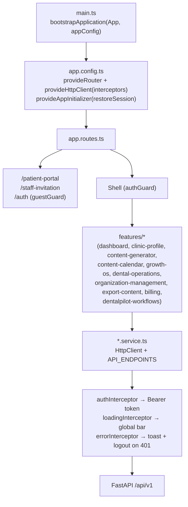

# DentalPilot AI — Frontend

Angular 21 single-page application for DentalPilot AI. It talks to the FastAPI backend over a versioned REST API (`/api/v1`) and is served statically by Nginx in production.

> Backend contract: [`../backend/README.md`](../backend/README.md)
> Endpoint constants: [`src/app/core/constants/api-endpoints.const.ts`](src/app/core/constants/api-endpoints.const.ts)

---

## A. Frontend overview

### A.1 Versions

| Tool | Version | Source |
|---|---|---|
| Angular | `^21.2.0` | `package.json` |
| Angular CLI | `^21.2.7` | `package.json` |
| TypeScript | `~5.9.2` | `package.json` |
| Node.js | **20.19+ / 22.12+ / 24.x** | Angular 21 engine requirement |
| npm | `11.6.2` | `packageManager` |
| Tailwind CSS | `^4.3.3` | `package.json` |
| Vitest | `^4.0.8` | `package.json` |
| Prettier | `^3.8.1` | `package.json` |
| RxJS | `~7.8.0` | `package.json` |

### A.2 UI libraries

- **Tailwind CSS v4** — utility classes in templates; no component stylesheets.
- **No component library** (no Angular Material/PrimeNG). Reusable primitives live in `src/app/shared/ui/`.
- **Razorpay Checkout** — loaded globally via a `<script>` in `index.html` (not an npm package); ambient types in `src/app/shared/razorpay.d.ts`.

### A.3 Application architecture

- **Standalone components** — every component declares its own `imports`.
- **Zoneless** — no `zone.js`; change detection via signals.
- **Signals** — state is per-feature `signal()`/`computed()`, no NgRx.
- **Lazy loading** — each feature has a `*.routes.ts` loaded via `loadComponent`/`loadChildren`.
- **Functional guards/interceptors** — `authGuard`, `guestGuard`; `authInterceptor`, `loadingInterceptor`, `errorInterceptor`.



### A.4 Directory structure

```
src/
├── main.ts                     # bootstrap
├── index.html                  # root, fonts, Razorpay script
├── styles.css                  # Tailwind import + brand/shell/animations
├── environments/
│   ├── environment.ts          # dev: http://localhost:8000/api/v1
│   └── environment.prod.ts     # prod: https://api.dentalpilot.in/api/v1
└── app/
    ├── app.ts                  # root component (<dp-root>)
    ├── app.config.ts           # providers: router, HttpClient, interceptors, restoreSession
    ├── app.routes.ts           # top-level routes + guards
    ├── core/
    │   ├── constants/          # api-endpoints.const.ts (REST contract)
    │   ├── guards/             # auth.guard.ts, guest.guard.ts
    │   ├── interceptors/       # auth, error, loading
    │   ├── models/             # TypeScript interfaces/DTOs
    │   └── services/           # AuthService, TokenStorageService, NotificationService, LoadingService
    ├── shared/
    │   ├── forms/              # formFieldClass() Tailwind helper
    │   ├── ui/                 # PageHeader, EmptyState, StatCard, ToastContainer, LoadingBar
    │   └── razorpay.d.ts       # ambient global Razorpay types
    ├── layout/
    │   ├── shell/              # authenticated sidebar + topbar
    │   └── auth-layout/        # centered login/register/forgot-password
    └── features/
        ├── auth/               # login, register, forgot-password
        ├── dashboard/
        ├── clinic-profile/
        ├── content-generator/
        ├── content-calendar/
        ├── clinic-growth-os/
        ├── dental-operations/
        ├── organization-management/
        ├── export-content/
        ├── billing/
        ├── dentalpilot-workflows/
        ├── patient-portal/     # public patient identity, records, shares
        └── staff-invitation/   # public one-time staff activation
```

---

## B. Local development setup

> For the complete local environment (PostgreSQL, backend, workers, Redis), see [`../LOCAL_DEVELOPMENT.md`](../LOCAL_DEVELOPMENT.md). This section covers frontend-specific commands only.

### B.1 Prerequisites

- Node.js **22 LTS** recommended (20.19+ minimum).
- npm **11**.
- The backend running on `http://localhost:8000` (see [`../backend/README.md`](../backend/README.md)).

### B.2 Clone and install

```bash
# From the parent monorepo
cd products/healthcare/dental/dentalpilot-ai/frontend

# Reproducible install from the lockfile
npm ci
```

If you intentionally changed dependencies, use `npm install` to refresh `package-lock.json`.

### B.3 Configure the local environment

`src/environments/environment.ts` already points at the local backend:

```ts
export const environment = {
  production: false,
  apiBaseUrl: 'http://localhost:8000/api/v1',
};
```

No change is needed for local development. To use a different backend URL, edit this file.

### B.4 Start the dev server

```bash
npm start          # ng serve
```

Open **<http://localhost:4200>**.

`ng serve` uses the `development` build configuration (no optimisation, source maps) and the `development` serve configuration in `angular.json`.

### B.5 Connect to the backend

1. Start the backend (`uvicorn app.main:app --reload --port 8000`).
2. Ensure `CORS_ORIGINS` includes `http://localhost:4200`.
3. Log in at `/auth/login`.

### B.6 Tests

```bash
npm test           # ng test (Vitest via @angular/build:unit-test)
```

### B.7 Formatting / linting

There is **no `lint` script** in `package.json`. Prettier is available:

```bash
npx prettier --check "src/**/*.{ts,html,css}"
npx prettier --write "src/**/*.{ts,html,css}"   # format in place
```

### B.8 Production build

```bash
npm run build      # ng build (production configuration)
```

Output: **`dist/dentalpilot-ai/browser/`** (this is what the Dockerfile copies into Nginx).

Other scripts:

```bash
npm run watch      # ng build --watch --configuration development
```

### B.9 Hot reload

`npm start` runs the Angular dev server (`@angular/build:dev-server`) with the `development` configuration. Verified output:

```text
Watch mode enabled. Watching for file changes...
  ➜  Local:   http://localhost:4200/
```

| Change | Result |
|---|---|
| `.ts` component/service | Rebuild; browser updates |
| `.html` template | Rebuild; view updates |
| `.css` / `.scss` | Styles rebuilt and re-applied |
| `angular.json` / `package.json` | Dev server may restart |

No manual restart is required for ordinary edits. Production builds (`npm run build`) do not watch.

If changes are not detected (network shares, Docker volumes):

```bash
npm start -- --poll 1000
```

---

## C. Frontend coding guide

### C.1 Component creation

```bash
ng generate component features/my-feature/my-page --standalone --inline-style=false
```

Project conventions (see existing components):

- Standalone component with `templateUrl`, `imports`, `selector: 'dp-...'`.
- `inject()` for services; no constructor injection.
- `signal()` for local state; `computed()` for derived state.
- Tailwind classes directly in the template; no `.css` files.

```ts
import { Component, inject, signal } from '@angular/core';
import { PageHeader } from '../../../shared/ui/page-header/page-header';
import { MyService } from './my.service';

@Component({
  selector: 'dp-my-page',
  imports: [PageHeader],
  templateUrl: './my-page.html',
})
export class MyPage {
  private readonly myService = inject(MyService);
  protected readonly loading = signal(false);
  protected readonly items = signal<Item[]>([]);
}
```

### C.2 Services

Feature services are `@Injectable({ providedIn: 'root' })` (or provided by a route), use `inject(HttpClient)`, and build URLs from `environment.apiBaseUrl` + `API_ENDPOINTS`:

```ts
import { HttpClient } from '@angular/common/http';
import { Injectable, inject } from '@angular/core';
import { environment } from '../../../environments/environment';
import { API_ENDPOINTS } from '../../core/constants/api-endpoints.const';

@Injectable({ providedIn: 'root' })
export class MyService {
  private readonly http = inject(HttpClient);
  private readonly baseUrl = environment.apiBaseUrl;

  list() {
    return this.http.get<Item[]>(`${this.baseUrl}/${API_ENDPOINTS.healthcare.patients}`);
  }
}
```

### C.3 API calls and error handling

Return `Observable`s and let the global `errorInterceptor` show a toast. Components subscribe with `async`-style patterns or signals:

```ts
this.myService.list().subscribe({
  next: (items) => this.items.set(items),
  error: () => this.items.set([]), // interceptor already showed a toast
});
```

Do not swallow `401`: the `errorInterceptor` logs the user out automatically (except for patient-portal requests).

### C.4 Routing

Routes are defined in `app.routes.ts` and feature `*.routes.ts`:

```ts
{
  path: 'my-feature',
  canActivate: [authGuard],
  loadChildren: () => import('./features/my-feature/my-feature.routes').then((m) => m.MY_ROUTES),
}
```

Public routes (`/patient-portal`, `/staff-invitation`) are outside the `authGuard`; `/auth/*` uses `guestGuard`.

### C.5 Route guards

- `authGuard` — redirects to `/auth/login?returnUrl=...` when unauthenticated.
- `guestGuard` — redirects authenticated users away from `/auth/*`.

### C.6 Authentication

- `AuthService` — `login`, `register`, `forgotPassword`, `logout`, `restoreSession`.
- `TokenStorageService` — stores `dp_access_token` and `dp_refresh_token` in `localStorage`.
- `authInterceptor` — attaches `Authorization: Bearer <accessToken>` to API requests.
- `provideAppInitializer` calls `restoreSession()` once at bootstrap.

### C.7 Interceptors

Registered in `app.config.ts` in this order:

1. `authInterceptor` — bearer token.
2. `loadingInterceptor` — increments `LoadingService`.
3. `errorInterceptor` — toasts errors, logs out on 401.

### C.8 Form validation

Two patterns exist:

- **Reactive forms** (auth pages): `FormBuilder`, `Validators`, `ReactiveFormsModule`.
- **Template-driven** (some workflows): `FormsModule` with `ngModel`.

Use `formFieldClass(control)` from `shared/forms/form-field-class.ts` for consistent invalid/valid Tailwind styling.

### C.9 State management

Signals only. Per-feature `signal()` services; no NgRx, no global store.

### C.10 Loading states

`LoadingService` (global counter) + `LoadingBar` in the shell + `loadingInterceptor`. Feature-local loading uses a `signal(false)` and disables buttons while true.

### C.11 Notifications

`NotificationService.success/error/info(message)` → `ToastContainer` renders and auto-dismisses after 5 s.

### C.12 Reusable UI

| Component | Purpose |
|---|---|
| `PageHeader` | Title + subtitle + actions |
| `EmptyState` | Empty list placeholder |
| `StatCard` | Metric card |
| `ToastContainer` | Global notifications |
| `LoadingBar` | Top-of-page progress bar |

### C.13 TypeScript models

Shared DTOs live in `src/app/core/models/*.model.ts`. Keep them in sync with the backend Pydantic schemas (camelCase).

### C.14 Environment configuration

| File | Build | `apiBaseUrl` |
|---|---|---|
| `environment.ts` | `ng serve`, development build | `http://localhost:8000/api/v1` |
| `environment.prod.ts` | `ng build` (production) | `https://api.dentalpilot.in/api/v1` |

`angular.json` swaps the file via `fileReplacements`.

---

## D. API integration guide

### D.1 Base URL

`environment.apiBaseUrl` — `http://localhost:8000/api/v1` locally, `https://api.dentalpilot.in/api/v1` in production.

### D.2 Authentication token handling

- `TokenStorageService` stores access + refresh tokens in `localStorage`.
- `authInterceptor` attaches `Authorization: Bearer <accessToken>` to every API request.
- **There is no automatic refresh.** When the 30-minute access token expires, the next request returns `401` and the `errorInterceptor` logs the user out. Re-login.

### D.3 Request/response patterns

- JSON request/response, camelCase.
- Success: the typed model or `204` for deletes.
- Error: `{ statusCode, message, errors? }`.

### D.4 CORS

The backend must allow the frontend origin via `CORS_ORIGINS` (JSON array), e.g. `["http://localhost:4200"]`. Credentials are enabled.

### D.5 Endpoint mapping (source of truth)

| Frontend group | Backend router prefix | Example |
|---|---|---|
| `auth` | `/auth` | `POST /auth/login` |
| `clinic` | `/clinic` | `GET /clinic/profile` |
| `content` | `/content` | `POST /content/generate` |
| `calendar` | `/calendar/events` | `GET /calendar/events` |
| `export` | `/export` | `POST /export` |
| `billing` | `/billing` | `GET /billing/subscription` |
| `dashboard` | `/dashboard`, `/analytics` | `GET /dashboard/summary` |
| `healthcare` | `/healthcare` | `GET /healthcare/patients` |
| `growth` | `/growth` | `GET /growth/campaigns` |
| `operations` | `/operations` | `GET /operations/dental-cases` |
| `organizations` | `/organizations` | `GET /organizations/current` |
| `integrations` | `/integrations` | `GET /integrations/catalog` |

Full constants: [`src/app/core/constants/api-endpoints.const.ts`](src/app/core/constants/api-endpoints.const.ts). Full backend routes: [`../backend/README.md`](../backend/README.md#d-api-developer-guide).

---

## E. Railway production deployment (frontend)

> For the full multi-service production deployment (backend, worker, PostgreSQL, domains, TLS, migrations, rollback), see [`../RAILWAY_DEPLOYMENT.md`](../RAILWAY_DEPLOYMENT.md). This section covers the frontend service only.

### E.1 Build-time vs runtime configuration — read this first

- **Angular environment is build-time.** `environment.prod.ts` is compiled into the JavaScript bundle by `fileReplacements` during `ng build`. Changing an environment variable in Railway **does not** change the API URL.
- **Nginx is runtime.** `frontend/nginx.conf` controls routing, headers, caching and the `/api/` proxy. It is baked into the image but can be swapped by mounting a config in Compose.

To point the frontend at a different API, edit `src/environments/environment.prod.ts` **before building**. There is no runtime `window.__CONFIG__` injection in this project.

### E.2 Create the service

1. Railway → **New Project** → **Deploy from GitHub repo** (`saman2ny/otheryn-platform`).
2. Add a **service** from the repo.
3. **Settings → Source → Root Directory**: `products/healthcare/dental/dentalpilot-ai/frontend` (if connected to `otheryn-platform`). If you connected the standalone DentalPilot repo, use `frontend`.
4. Railway detects the **Dockerfile** at the root of that directory (`frontend/Dockerfile`) and builds it.

### E.3 Dockerfile build

`frontend/Dockerfile`:

1. `node:20-alpine` builder.
2. `npm ci`.
3. `npm run build` → `dist/dentalpilot-ai/browser`.
4. `nginx:alpine` runtime.
5. Copies `dist/dentalpilot-ai/browser` → `/usr/share/nginx/html`.
7. Copies `nginx.conf` → `/etc/nginx/conf.d/default.conf`.

### E.4 Nginx configuration

`frontend/nginx.conf`:

- Listens on `80`.
- Serves the SPA with `try_files $uri $uri/ /index.html`.
- Proxies `/api/` to `https://api.dentalpilot.in` (preserving the `/api` prefix).
- `/health` returns `200 healthy`.
- Adds security headers (X-Frame-Options, nosniff, Referrer-Policy, CSP). HSTS is not set in `nginx.conf`; add it at the edge if required.
- Caches hashed static assets for 1 year.

### E.5 Public domain and HTTPS

1. Railway → service → **Settings → Networking → Generate Domain** (e.g. `dentalpilot-production.up.railway.app`).
2. For a custom domain (e.g. `dentalpilot.in`), add a **CNAME** to the Railway hostname at your DNS provider.
3. Railway provisions TLS automatically once the domain is verified.

### E.6 Deployment verification

```bash
curl -I https://<your-domain>/health          # 200, content-type text/plain
curl -s  https://<your-domain>/ | head -5     # index.html
curl -I https://<your-domain>/                # security headers
```

Then open the domain and log in.

### E.7 Rollback

Railway → service → **Deployments** → select a previous deployment → **Redeploy**. Confirm the deployed commit in **Details**.

---

## F. Frontend troubleshooting

| Problem | Fix |
|---|---|
| `npm ci` fails with `EUSAGE` | `package-lock.json` out of sync — run `npm install` and commit the updated lockfile |
| Node version error during `npm ci` | Use Node 20.19+/22.12+/24 (`nvm use 22`) |
| `ng: command not found` | Run `npm ci` first; use `npx ng ...` if needed |
| Angular compile error after pull | `rm -rf node_modules dist .angular && npm ci` |
| Missing dependency at runtime | `npm ci`; never edit `node_modules` |
| `ng serve` works but API calls fail | Backend not running on `:8000`; check `environment.ts` |
| CORS error in browser | Add `http://localhost:4200` to backend `CORS_ORIGINS` and restart the backend |
| `401` after 30 minutes | Access token expired; re-login (refresh is not automatic) |
| Nginx `502` in Docker/Railway | The `/api/` proxy target is unreachable; the frontend expects `https://api.dentalpilot.in` |
| Nginx `413` on upload | Increase `client_max_body_size` (not set in the current config) |
| Docker build fails at `npm ci` | Ensure `package-lock.json` is present in the build context |
| Docker build fails at `npm run build` | Check Node version (Angular 21 needs ≥20.19) and memory |
| Railway build fails | Root directory must point at the folder containing `Dockerfile` and `package.json` |
| Railway app shows blank page | Check the browser console; confirm `environment.prod.ts` API URL and that the API domain is reachable |
| Railway `/health` returns 404 | The service is not the frontend; verify the root directory/Dockerfile |

---

## G. Related documentation

- [`../README.md`](../README.md) — product overview and local quick start.
- [`../LOCAL_DEVELOPMENT.md`](../LOCAL_DEVELOPMENT.md) — full local setup and hot reload.
- [`../backend/README.md`](../backend/README.md) — API contract and backend setup.
- [`../ENVIRONMENT_GUIDE.md`](../ENVIRONMENT_GUIDE.md) — local vs production.
- [`../RAILWAY_DEPLOYMENT.md`](../RAILWAY_DEPLOYMENT.md) — Railway services.
- [`../CONTRIBUTING.md`](../CONTRIBUTING.md) — contribution workflow.